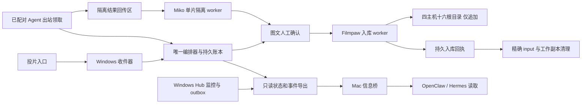

# 媒体工作流：架构与安全契约

日期：2026-10-19。状态：设计交付，尚未实施或完成运行验收。

本文件是[媒体工作流 EPIC](2026-10-19-media-workflow-epic.md)的规范附录；拆分与实施顺序见[开发计划](2026-10-19-media-workflow-development-plan.md)。文中的“必须”“禁止”是后续实现和验收的约束，不代表现有版本已经具备该能力。

## 1. 目标、部署决定与范围

用户持续将 `Actor/Film/files` 影片包放入主控本机的普通 INBOX 目录，系统自动监听并判断就绪，完成多机分配、LTX 修复、语音识别和字幕翻译、结果回传、Miko 完整后处理、Filmpaw 演员及 NAS 位置匹配，随后提供图文确认。正常路径最终只需一次“确认入库”，不增加技术风险勾选；确认后追加归档，核验成功并持久保存回执，再自动清理授权范围内、仍与批准快照一致的 input 和成品工作副本。用户不需要安装投递端、逐片提交、手写 ready 文件或向各计算机分别投片。

部署固定为：

- **本机 Windows 是唯一主控**：整个旧 Hub 的普通及工作流节点、监控历史和通知迁至 Windows，不只迁移五台计算节点；运行 Hub、媒体编排器、收件和入库 worker，同机也是一台 5060 8GB / 1080p 计算 Agent 和开发机。
- **初始五台计算 Agent**：5070 Ti 16GB 与 5060 Ti 16GB 可以领取 4K、1080p；三台 5060 8GB 只领取 1080p。两台 16GB 优先处理 4K，空闲时可补充 1080p。五台不是硬上限，后续设备按第 6 节动态登记和验证能力。
- **Mac mini 只提供信息桥**：以独立轻量 Info Bridge 包给 OpenClaw/Hermes 提供全机群状态和有界事件缓存，包含普通监控节点及工作流节点；不带完整 React/Tauri、模型或 GPU 组件，不调度、不领取任务、不运行第二套主控，不复制视频或主控数据库。
- **正式 NAS 区域**：四台主机上的十六个注册根目录，只允许向新目标追加本次已批准的影片包，禁止删除或覆盖既有 NAS 内容。

这项部署决定替代 [V3 总体设计](2026-06-27-taskpaw-v3-design.md)中的固定 Mac Hub 拓扑假设；其余协议、安全和生命周期规则仍受[宪法](../constitution.md)约束。V2 不承接本功能。8K VR、跨公网调度、自动双主切换及通用远程命令执行不在本轮范围内。

## 2. 现有能力与新增边界

以下是源码事实，不是现场部署验证。TaskPaw 调研基线为 `3fc956b`，与合并节点 `885ead2` 的 Git tree 相同。跨仓库链接固定到调研提交，避免将后续变化误当成本设计的证据。

| 范围 | 现有能力和证据 | 本 EPIC 必须补齐的边界 |
|---|---|---|
| 本地影片执行 | [jasna.py](../../taskpaw_v3/monitors/plugins/jasna.py) 的 `plan_queue`、`_launch_locked`、`_publish_current` 提供目录扫描、逐片启动和工作输出发布；`run_films` 暴露影片步骤信息 | 当前目录队列不是持续收件、持久分布式任务或内容清单；不能以文件存在、运行计数或输出文件名证明交付完成 |
| 资源协调 | [gpu_lease.py](../../taskpaw_v3/core/gpu_lease.py) 是进程内 arbiter，使用实例及 generation 防止旧 release 释放新 owner | 不是跨进程、逐物理 GPU 或跨机器的租约；当前停止路径不能一概视为原生进程已退出，必须落实 #225 的释放条件 |
| 字幕与恢复 | [job.py](../../taskpaw_v3/monitors/subs/job.py)、[checkpoint.py](../../taskpaw_v3/monitors/subs/checkpoint.py)、[translate.py](../../taskpaw_v3/monitors/subs/translate.py) 已有字幕保留、逐句翻译 checkpoint 和服务失败处理 | 现有本地 checkpoint 不等于跨机迁移或 LTX 片内续算；需要持久的阶段输入、输出及版本关联 |
| 影片观测 | [progress.py](../../taskpaw_v3/monitors/subs/progress.py) 的 `FilmTracker` 和 [Agent API](../../taskpaw_v3/agent/server/app.py) 的影片查询可复用 | 内存步骤记录不承担持久工作流账本；没有领取、交付清单或归档回执协议 |
| Hub | [Hub API](../../taskpaw_v3/hub/server/app.py)、[poller.py](../../taskpaw_v3/hub/server/poller.py) 提供监控轮询、历史、事件去重和通知 outbox | 现有网络面是观测面，不能将其改造成任意远程 `/control` 转发器 |
| 现有壳与打包 | [App.tsx](../../taskpaw_v3/ui/src/App.tsx) 的 packaged role 固定为 agent/hub；[build.py](../../scripts/build.py) 构建 TaskPaw backend sidecar，[Tauri 配置](../../taskpaw_v3/src-tauri/tauri.conf.json) 目前仅包含它 | 需在现有壳中新增媒体 workspace 与安装角色，不能把开发角色 tab 当成已交付的组合主控或统一组件安装器 |
| 设备管理 | [HubAgentManager.tsx](../../taskpaw_v3/ui/src/components/HubAgentManager.tsx) 已支持监控节点名称、IP、端口、启用和删除；[store.py](../../taskpaw_v3/hub/server/store.py) 的 `remove_server` 会清理关联历史、事件和 outbox | 工作流节点另需配对、能力与安全退役；不能直接套用删除历史的旧语义来遗忘任务 owner |
| GPU 上报 | [jasna.py](../../taskpaw_v3/monitors/plugins/jasna.py) 的 `query_gpus` 与 [host_metrics.py](../../taskpaw_v3/monitors/plugins/host_metrics.py) 有显存和使用率信息 | 仍需稳定 worker/GPU 身份、允许分辨率、模型版本、磁盘余量与本地 owner 状态；瞬时利用率不能证明可调度 |
| Miko | [单片及重试 API](https://github.com/AlvinShenSSW/MDCX304/blob/fade13561ea247584c8c50847a09f70c66a4b62b/mdcx/server/api/v1/scrape.py) 已有单片入口和重试路径 | 全局配置与内存任务状态需要隔离、持久适配；返回成功不能替代本次影片包的输出核验。该仓库为私有仓库，源码链接需仓库权限 |
| Filmpaw | [transfer.py](https://github.com/AlvinShenSSW/Filmpaw/blob/acbb1b5de9bc5af9d8434fdb3c6f0246edf4bd13/app/server/filmpaw_server/transfer.py) 已有复制校验及提交后的来源清理；[演员路由](https://github.com/AlvinShenSSW/Filmpaw/blob/acbb1b5de9bc5af9d8434fdb3c6f0246edf4bd13/app/server/filmpaw_server/routes_performers.py) 可按名称及别名查找 | 需要多根目录候选、审批绑定、整包回执与精确清理契约。现有成品来源清理不等于原始 input 清理，名称匹配也不等于演员身份确认 |

现有监控协议 `/ping`、`/status`、`/events`、事件 ID 与 ack lineage 保持兼容。新编排能力是独立的任务协议和持久账本，可与 Hub 打包、同机运行并共享界面，但不能以改写观测 JSON 的方式隐式发出执行指令。

## 3. 组件与权限边界



编排器管理任务、审批、分配和恢复；Agent 管理本机执行、资源 owner 与结果；Miko 管理单片刮削；Filmpaw 管理索引、目标目录与归档提交。编排器账本与监控历史是不同的逻辑数据域，不从“最近一次状态正常”推断任务已提交。第一版无需引入外部分布式消息系统。

旧 Agent、Hub `/control` 继续只绑定 loopback。新增 LAN worker API 必须使用单独身份和权限，不能复用监控只读 token 获得执行权。Agent 只出站领取白名单阶段，提交心跳、结果及核对响应；不能通过 payload 指定任意命令、任意绝对路径或任意 NAS 目标。具体路由及端口由 T01/T03 冻结并检查冲突，不能悄悄占用既有端口。

任务使用逻辑 artifact ID、预登记 profile 和根目录 ID；Agent 在本机受限工作目录内解析。网络操作必须鉴权，凭据不出现在 argv、日志或任务清单。只读消费者无 claim、审批、归档、清理权限。共享同一主机不意味着共享所有凭据或数据库写入权。

### 3.1 安装角色与交付范围

Windows TaskPaw 保留普通安装和既有使用路径。仅做字幕翻译、监控或其他现有任务的机器，无须选择媒体工作流角色；升级不改变其界面和已保存的用途。仅当用户明确启用媒体工作流时，安装/设置向导才提供以下两种工作流角色：

| 安装角色 | TaskPaw 安装流程管理的组件 | 权限边界 |
|---|---|---|
| 主控＋Agent | 现有 TaskPaw 壳、唯一 Hub/编排服务、本机 Agent、Miko 后台、Filmpaw 后台，以及本机需要的 GPU/字幕工具 | 负责审批和归档，但仍受单主、单库 owner 与 NAS 追加契约约束 |
| 计算 Agent | 现有 Agent 界面、常驻 Agent、领取/回传适配、所需 GPU/字幕工具与模型准备 | 不安装 Miko/Filmpaw、主控数据库，不取得审批、归档或 NAS 写凭据 |

用户无需分别安装、打开或日常操作 Miko/Filmpaw GUI。一个安装流程可以包含独立、有版本的后台组件和按需下载；不要求将三套源码或 Python 依赖合并成一个 EXE/环境。安装器核验组件来源、hash、平台及兼容版本，下载/准备/失败状态在 TaskPaw 内展示。模型下载仍按 TaskPaw 的确认与进度契约执行；工具或驱动未准备时节点不得领取相关任务。

首次角色向导完成主控连接/配对、工作目录与能力配置、模型下载确认和依赖预检。用户明确选择“启用工作流”后，由 TaskPaw 幂等建立该角色的执行配置和对应观测记录；不要求再手动添加 Jasna 或其他 monitor。未完成预检或未明确启用时不得领取和执行；重复进入向导不能创建第二个执行者。主控配置唯一 INBOX，远端只配置自动领取所用的受控工作目录。

未启用工作流的普通节点不因安装、升级、Hub 发现或监控注册而下载 LTX、创建工作流执行配置或获得领取资格；仍可按现有方式添加 monitor 和使用字幕翻译。发现已有翻译端点也不授予工作流调用权，工作流使用该端点须另有明确配置、授权与并发限制。

角色变更属于设置/迁移操作，需处理服务、数据与在途 owner；不是日常页面切换。原型的角色展示切换必须标为演示。Mac 只安装独立 Info Bridge，不提供角色提升或备用主控能力。

### 3.2 后台入口与组件兼容性

Miko 的 [launcher.py](https://github.com/AlvinShenSSW/MDCX304/blob/fade13561ea247584c8c50847a09f70c66a4b62b/mdcx/server/launcher.py) 已提供 `mdcx-server`、独立 config-dir/safe-dirs、环境凭据和就绪信息；[server 打包规范](https://github.com/AlvinShenSSW/MDCX304/blob/fade13561ea247584c8c50847a09f70c66a4b62b/scripts/mdcx-server.spec) 排除 PyQt，但仍包含预构建 Web 资源及相关依赖。Filmpaw 的 [sidecar 构建入口](https://github.com/AlvinShenSSW/Filmpaw/blob/acbb1b5de9bc5af9d8434fdb3c6f0246edf4bd13/app/server/build_sidecar.py) 和 [main.py](https://github.com/AlvinShenSSW/Filmpaw/blob/acbb1b5de9bc5af9d8434fdb3c6f0246edf4bd13/app/server/filmpaw_server/main.py) 可作为后台基础。它们不等于现有版本已经支持 TaskPaw 一键托管。

每次主控发布冻结兼容矩阵：workflow schema、Agent 协议范围、Miko/Filmpaw adapter 与组件版本、Filmpaw DB schema、工具/模型 profile、OS/CPU 架构。当前 TaskPaw Python 约束 `>=3.10`、Miko `>=3.13.4,<3.14`、Filmpaw `>=3.13`，不能假定共享一个运行环境兼容。分别构建组件并通过版本化协议集成；Miko 的浏览器/静态资源等按所用功能预检。真实组合打包、签名、发行依赖、干净机器安装及升级是后续 T05/M01/F02/T09 的交付，不能由已有构建脚本推定已通过。

## 4. 持久身份、清单与状态

### 4.1 最小记录

| 记录 | 必须包含的身份和约束 |
|---|---|
| `Film` | 随机稳定 `film_id`、来源收件 session、展示名称、当前 manifest revision；文件夹名、番号和演员名都不是唯一主键 |
| `Manifest` | `film_id`、单调 revision、规范化清单 hash；每项的逻辑角色、受限相对路径、字节数、内容 hash、来源及原生文件身份；父目录/分卷关系、媒体探测结果与操作性就绪证据及策略版本 |
| `StageAttempt` | `job_id`、阶段、attempt ID、输入清单 hash、工具/模型/profile 版本、worker ID、worker boot ID、master epoch、fencing token、状态及明确错误类别 |
| `Assignment` | 当前 owner、领取及续约记录、租约期限、被接受的本地 owner 证明；同一阶段最多一个未核销执行 owner |
| `Worker` | 稳定 worker ID、credential generation、boot ID、地址、显式工作流 membership/角色及授权 revision、声明/探测/已批准能力、登记与退役状态；关联监控记录和历史，但不以 IP 或显示名称作身份 |
| `ArtifactReceipt` | attempt、实际输出清单 hash、接收端核验和持久化结果；“上传结束”与“已核验接纳”分开 |
| `Approval` | 见第 8 节；批准影片版本、目标身份和精确清理范围，不能只是一个 `approved=true` |
| `ArchiveReceipt` | 归档 operation ID、审批 ID、目标根及目标目录身份、全包清单 hash、提交状态和持久记录位置 |
| `CleanupRecord` | input 与成品工作副本分别记录 intent、逐文件结果、跳过原因和重试状态，引用已核验归档回执 |

角色包括主视频、已有字幕、生成字幕、NFO、图片及其他明确允许的附件。相对路径禁止越界、大小写归一冲突、非预期 reparse point 或跨根引用。目录演员名仅作提示，多演员或同名演员不能自动选第一个。

所有对外可读文件原子发布；任务账本更新、领取和提交使用事务或等价的持久原子条件更新。API 重试必须带幂等键，重复请求返回同一 operation/receipt，而不是生成第二份任务。事件以稳定 ID 关联状态变化，日志不是恢复状态的唯一来源。

### 4.2 阶段和局部恢复

```text
receiving → intake_verified → queued → restore → asr → translate
          → return_verified → scrape → awaiting_approval → archive
          → archive_verified → cleanup_pending → completed
```

上图是影片流程，修复与字幕步骤可按有证据的策略复用，但 Miko 完整后处理是进入最终确认的必经阶段，不能因为已有 NFO/图片而跳过。每个阶段单独持久记录 `pending / running / succeeded / skipped / failed / unknown / blocked`；允许跳过的阶段必须有原因与输入证据。流程成功不能由“队列已清空”代替。`intake_verified` 表示第 5 节操作性就绪和快照核验已通过，不表示已证明外部复制事务完成。

- 已有合格字幕可按策略省略 ASR/翻译；选择哪份字幕、语言及视频对应关系进入清单。保留来源附件，不覆盖用户已有字幕。
- LTX 失败默认从该片修复阶段重做，**不承诺片内帧级续算**。复用已完成视频必须有相同输入、profile 和核验清单，不能仅检查同名文件存在。
- ASR 已验证的转录和翻译 checkpoint 可用于局部恢复；绑定转录内容、语言和配置版本。现有 checkpoint 文件不经核验就不能作为跨机恢复依据。
- 字幕失败可以保留修复成品并重试字幕；无法翻译或只有日文字幕必须明确显示。影片策略要求的字幕未完成时不能归档；如用户明确修改要求，生成新策略/清单版本后重新确认，不能以点击确认隐式跳过必需产物。
- Miko、回传、归档和清理失败各自恢复，不默认重做前面的 GPU 阶段。手动重试创建新 attempt，保留旧记录。
- 迟到附件或用户修改形成新 manifest revision；使依赖旧输入的后续结果、审批或清理范围失效，需要按依赖重新核对。已成功归档的历史不被改写。

## 5. 无额外提交操作的持续收件

只有一个用户投片入口和一份主控原始 input。各 Agent 的输入暂存、输出及缓存目录由系统按任务建立，它们是受控工作副本，不是需要用户再投片的第二至第五个 input。中央收件与下发、远端工作副本及回传清单分别记录；清理允许根也按这些角色区分。

### 5.1 默认普通目录与操作性就绪

默认入口是主控本机配置的普通 INBOX，用户直接用文件管理器放入影片目录。文件变化监听负责及时发现，定时补扫负责补偿漏事件、服务重启和监听中断；按持久的目录/文件身份合并重复发现，不重复建片。稳定窗口、补扫周期及资源上限属于可配置且有版本的后台策略，不要求每片选择技术模式。

收件器自动执行以下准入检查：

1. 按演员/影片/分卷和附件关系枚举候选包；观察成员集合、文件身份、大小和修改证据经过稳定窗口未变。变化重置该包窗口，其他已就绪影片可独立推进。
2. 检查共享写占用，并以受支持的 Windows 共享/句柄约束阻止快照读取期间的并发修改；仍有写者、无法取得约束或身份不明时保留 `receiving/blocked`，有界重试，不猜测复制已完成。
3. 完成媒体探测及全部成员的完整读取/hash，核对目录成员和原生身份在快照建立前后未变化。确定分辨率、流信息和文件可读性；损坏、未知媒体或附件配对歧义进入待处理状态。
4. 将稳定的整包清单、输入原生身份、hash、就绪检查结果及策略版本持久化为不可变 snapshot；建立私有工作副本并验证其与 snapshot 相同后，才进入 `intake_verified/queued`。监听继续观察原 INBOX，后续变化生成新 revision 并触发依赖核对。

上述是本产品选择的**操作性就绪判定**，不是外部复制完成的数学证明。hash 证明读取到的内容及副本一致，写占用检查证明当前可取得所需读取约束；二者均不能证明用户稍后不会续拷或补附件。实现必须测试读取/复制期间变化、共享写者和枚举竞态，不能将仅一次 size/mtime 稳定当作全部检查通过。

### 5.2 自动清理资格与剩余假设

普通目录输入经过操作性准入可以正常处理和自动清理，不标成永久“只能归档、保留全部来源”。最终入库批准绑定该不可变 snapshot；NAS 全包验证及 durable receipt 后，按第 9.2 节重新核对当前源成员、原生身份、内容及写占用，只清理仍符合批准清单的对象。实际新增/变化、仍在写入或身份未知才暂停受影响影片的 input 清理，保留 `cleanup_pending` 和具体原因；不得为了清理而扩展旧 snapshot 或删除新文件。

必须诚实保留一个剩余假设：复制中断后长期静止的短文件，若仍能通过媒体探测和完整读取，也可能被当作就绪；尚未出现的附件同样无法由 watcher 发现。即使后续源与 snapshot 完全一致，也不能从这些检查反推外部原件完整。这是默认效率方案的技术局限，进入实现风险及中断复制/迟到附件的原生验收记录，不转化为逐片风险勾选，也不承诺绝对安全。若部署场景不能接受该假设，应停止自动处理并重新选择接收策略，不能暗中声称严格完整性。

具有发送端完成信号的托管复制/自动 commit 可作为未来可选增强；它不是当前默认入口、安装步骤或交付前置。普通 INBOX 不依赖发送端包装器或额外 ready/提交操作。

### 5.3 接收通用规则

- 按上下文识别一片一包，保留 `Actor/Film/files` 下的字幕、NFO 和图片。目录内可可靠区分的不同影片分别派发，但保留父目录和共享附件关系；同一影片的明确分卷记录卷序与字幕对应，不拆成无上下文的独立片。多版本或无法可靠配对的组合进入异常队列，不任意选择第一项。
- `receiving`、上传中、校验失败、媒体信息未知的影片都不进入 GPU 可领取队列。分辨率探测失败不得默认按 1080p 派给 8GB Agent。
- 所有复制、hash 和 probe 都有资源与时间边界；网络文件操作不能堵住主控事件循环。计算只读取已核验的不可变工作副本。
- 相同内容重复投递可提示已有 Film/归档记录，但番号或名字相同不足以去重。不同版本保留独立身份并交给人工决定。
- 投递源、input、Agent 工作副本与 NAS 成品分别记录清单。清理收件 input 不自动授权删除用户电脑上未纳入清理清单的投递原件。

## 6. 领取、GPU 归属与离线行为

### 6.1 能力与选择

Agent 上报稳定 worker ID、boot ID、软件及协议版本、物理 GPU 身份、显存、允许的分辨率/profile、模型安装状态、临时磁盘容量、当前 owner 及资源冲突。能力声明经注册策略约束，不能靠客户端自称 16GB 绕过管理端的 1080p 限制。下表是初始登记策略，不是支持型号或节点数量的硬编码上限。

| Worker 类别 | 可领取 | 优先级与准入 |
|---|---|---|
| 5070 Ti 16GB、5060 Ti 16GB | 4K、1080p | 优先 4K；满足模型、磁盘和本地资源条件后再领取 |
| 三台 5060 8GB | 1080p | 4K 硬性不准入；不能通过把未知分辨率归为 1080p 降级绕过 |

分配先过滤硬能力，再按排队时间、任务优先级和可用资源选择；16GB 机器不能因持续 1080p 流量使 4K 永久饥饿。性能估算使用同类设备、模型/profile、分辨率和帧数的实际样本，初期显示未知，不用产品型号推导精确 ETA。首次模型下载确认和准备属于模型准入；不能在领取后静默触发无限下载。

### 6.2 中央 assignment 与本地资源 owner 分离

中央 assignment 控制谁可以领取、交付和产生后续副作用；本地 owner 负责实际进程树、GPU 与磁盘。两者都成立才能启动。Agent 在启动前持久写入 assignment 与本地 owner 记录，启动后记录可核对的进程身份；不能先启动 GPU 再补写任务归属。

现有进程内 `GpuLease` 可以作为适配基础，不能独立承担跨进程服务隔离。在已启用工作流的物理 GPU 上，LTX、ASR 和同卡本地翻译模型必须进入同一个资源准入范围，本地手动任务也必须登记其占用。无法核对的外部 GPU 占用暂停该卡自动准入，不能通过杀掉非本系统拥有的进程取得资源。经明确授权的远端翻译服务走单独并发限额；不能因为调用形式是 HTTP 就假设不会占用本机 GPU。第一版默认单 GPU 上一次只接纳一个需要独占显存的计算阶段；只有实际验证的 profile 才允许受控并发。

停止、超时或取消后，必须证明受管进程树和关联 I/O owner 已结束才释放 GPU。原生清理不明、旧进程仍活着或停止失败时保留 owner，阻止新 GPU 任务；不能仅凭 `Popen` 对象丢失、租约超时或停止请求已返回来释放资源。此处依赖 #225 的清理契约。

### 6.3 租约过期不等于可以重派

领取使用事务条件更新，分配包含 master epoch 与单调 fencing token。重试相同领取幂等；续约仅接受当前 worker/attempt/epoch。调度器使用自身时间判断期限，进程内等待使用 monotonic；不比较不同机器时间字符串来决定 owner。

当续约中断或 Agent 失联时，中央把 assignment 标成 `unknown`，暂停其后续副作用，**不立即派给另一台机器**。离线 Agent 可以完成已经领取、输入和配置均已在本地的计算单元，将结果和阶段账本保存在本地；不能领新片、扩展未授权阶段或自行归档/清理 NAS。

恢复连接后，必须先交换持久任务与 owner 状态，核对当前 attempt、进程身份及已完成 artifact，再允许领取新任务。结果回报重复或回复丢失时查询相同 operation；旧 epoch/attempt 的结果进入待核对区，不能覆盖新结果。无法证明旧执行已终止时，不得仅通过增加 token 让第二个 GPU 同时执行同一阶段。

如果机器永久不可达，需要明确的隔离或关机证据及人工恢复决定才能重派。fencing 能拒绝旧结果提交，不能让旧 GPU 自动停止，也不能撤回一个已经持有 NAS 写权限的旧进程。

### 6.4 动态登记、手填与探测

Hub 监控注册与工作流 enrollment 是独立契约。T01/T03 持久记录是否显式加入工作流、角色及授权 revision，并在领取准入时核验；普通监控记录、在线状态、GPU 探测或已存在的翻译服务都不能隐式生成 membership。普通节点继续使用现有监控管理，不自动进入工作流计算池。

设备页支持新增、编辑、停领、恢复和移除。表单包含名称、LAN 地址/端口、CPU/内存、GPU 型号/显存及拟启用 profile；可手填或从已安装的 Agent 探测。用户声明、探测结果和最终批准能力分开保存，附来源和时间；探测失败不抹去手填信息，也不能把声明伪装成实测。

4090 或其他型号可以登记，调度资格取管理策略、可信探测、工具/模型准备与经验证 profile 的交集。未知型号、声明冲突或缺少 profile 时可保存为待验证节点，不能仅靠型号/显存获得 4K、8K 或并发资格。能力变更影响新任务准入，不改写已领任务的冻结 profile。

入网流程为“待配对 → 验证 worker 身份与协议 → 探测并核对能力 → 确认 profile → 启用领取”。一次性配对凭据有时效、防重放且只用于该节点注册；后续使用独立受限身份。地址用于监控/限定探测，Agent 出站领取；填写地址不授予远端 loopback control 权限。地址变化需核对身份，相同 IP/名称不能覆盖旧 worker 或 owner。

### 6.5 安全退役与重新加入

节点登记至少区分 `pending_pairing / pending_validation / active / draining / retiring / retired`；失联及 assignment 的 `unknown` 不因界面移除而消失。

正常移除先停止新领取，显示在途任务、未回传结果及未知 owner；等待其完成并核对，或显式停止受管工作。证明 owner 收束、交付状态明确后，撤销凭据并退休。单纯停领不杀任务，显式停止另行展示影响。主控本机的 Agent 可独立退休，不能连带关闭唯一 Hub。

失联时允许撤销未来领取权限，但必须保留 `revoked + unresolved ownership` 记录，不立即重派或清理远端文件。撤销凭据不停止旧 GPU；恢复结果需通过受限、可审计的核对通道关联旧 attempt，不恢复新领取权。退役保留影片、attempt、receipt、event cursor、outbox 及节点历史，可从活跃列表隐藏但不得级联删除。不能直接调用会清历史的既有 `remove_server`；旧纯监控删除动作与工作流退役需明确区分。

普通重启保留 worker ID，改变 boot ID 并先恢复核对。退休后重新加入则使用新 worker ID/凭据，不能自动继承旧授权或覆盖历史；旧 token、heartbeat 和 late result 不得复活旧身份。若同一物理 GPU 仍关联旧未知 owner，新身份也不得开始冲突计算，必须先完成停止或结果核对。

## 7. 执行、回传与 Miko

每个 attempt 使用独立工作目录和输出 namespace，不共用跨机器同名输出路径。现有 Jasna 发布逻辑只用于受控工作区，禁止直接指向正式 NAS 根。LTX 输出、字幕和其他产物完成后产生输出 manifest；回传先到 Windows 隔离接收区，完整核验后才发布 `return_verified`。复制进度 100% 不等于整包交付。

回传超时或连接断开先查询该 operation 的接收状态，核对已收到的清单、hash 和所属 attempt。只能恢复确认属于本次 operation 的部分内容；不能把未知半成品当成功，也不能在未知状态下创建第二套同名回传。Agent 在收到持久接收回执前保留所需产物。

Miko 使用单片隔离 worker 和独立配置快照，同一全局配置 owner 串行处理影片。不能并行改写用户正在使用的全局配置，也不能把 API 的内存 task ID 当作持久阶段完成记录。适配器记录请求幂等键、配置版本、真实最终输出路径、逐项成功/失败及 hash；只处理本片 staging，所有产出仍须检查与影片清单的对应关系。

### 7.1 完整后处理与实际成果

每个完成修复/字幕策略的影片包必须再执行 Miko 完整后处理，即便已有 NFO、封面或字幕。使用包含元数据、封面处理/标识、NFO 写入、附件整理及最终路径结果的完整模式；只读或仅整理模式的提前成功不满足本阶段。复用有效元数据不等于跳过流程，也不要求强制下载所有可选预告片/剧照。已完成且匹配当前输入、规则和输出 hash 的同一后处理结果可在恢复时核对复用，避免无意义重刮。

T04 向 M01 交付可信的实际修复状态、attempt/产物 hash、实际分辨率，以及每份字幕的视频关联、语言、非空/无语音等状态。Miko [现有标识规则](https://github.com/AlvinShenSSW/MDCX304/blob/fade13561ea247584c8c50847a09f70c66a4b62b/mdcx/core/image.py#L23)使用字幕、分辨率和 mosaic 等事实；未发现独立“AI 修复”标识，TaskPaw 不另造水印，也不能用旧文件名或 NFO 标签代替本次成果。成功修复到既有“破解”等规则的映射必须由 M01 明确定义并测试，失败/跳过不能伪标完成。

TaskPaw 的 `.zh.srt` 不在 Miko 默认字幕命名检测范围，且现有流程可能发布空字幕或保留其他语言字幕。适配必须把真实语言与内容状态传给 Miko，必要的 staging 命名映射不得改动原 input；仅存在 `.zh.srt`、旧 NFO 标为中文字幕或字幕阶段显示跳过，都不足以证明本次有有效中文字幕。具体采用版本化 API、隔离配置或 staging 映射由 T04/M01 实现时冻结。

### 7.2 最终封面与目录上下文

Miko [完整处理路径](https://github.com/AlvinShenSSW/MDCX304/blob/fade13561ea247584c8c50847a09f70c66a4b62b/mdcx/core/scraper.py#L941)仍可能受旧图缓存/配置影响；[保留旧图分支](https://github.com/AlvinShenSSW/MDCX304/blob/fade13561ea247584c8c50847a09f70c66a4b62b/mdcx/core/web.py#L714)及已标记状态可跳过更新。因此仅再次调用 API 不算封面验收通过。M01 必须在私有 staging 得到与实际成果一致的最终封面，清除旧标识的错误/遗漏而不重复叠加；必要时由 Miko 从干净图源重建。图片下载失败后回退旧图、配置忽略图片失败或总体 task 成功，均不能掩盖必需封面缺失/标识不符，未满足时进入明确异常。

保留父目录、多视频和分卷语义，复用 Miko [create_folder_jpg](https://github.com/AlvinShenSSW/MDCX304/blob/fade13561ea247584c8c50847a09f70c66a4b62b/mdcx/core/file.py#L42)的目录封面逻辑：适用包的 `folder.jpg` 必须来自本次最终 poster，并纳入最终 manifest、图文预览、审批、全包 hash 和归档回执。原函数的 best-effort 目录计数、缺 poster 跳过或复制失败只记日志不构成包成功；适用时缺失/失败必须阻断交付。同目录不同影片仍保留各自身份和父目录上下文，目录封面归属不明确时先核对，不能任意取第一片封面。刷新和覆盖只允许在本次 staging，不得调用该逻辑覆盖正式 NAS 的既有 `folder.jpg`。

已有 NFO、图片和字幕的取舍、刮削新增字段与重命名结果必须可追溯。NFO 演员姓名不是跨库稳定 actor ID；刮削成功不自动授权选择演员目录或写入 NAS。最终确认与归档只消费本次后处理验收通过的成品包；内容或封面改变生成新 manifest revision，不能沿用旧预览和审批。

## 8. 图文确认、演员匹配与目标身份

Filmpaw 继续作为自身索引数据库的唯一 owner；TaskPaw 调用其现有 targets/演员查询能力的扩展，不直接打开或修改 Filmpaw SQLite，也不另造一套无法对账的目标目录数据库。参考 [db.py](https://github.com/AlvinShenSSW/Filmpaw/blob/acbb1b5de9bc5af9d8434fdb3c6f0246edf4bd13/app/server/filmpaw_server/db.py) 与 [session.py](https://github.com/AlvinShenSSW/Filmpaw/blob/acbb1b5de9bc5af9d8434fdb3c6f0246edf4bd13/app/server/filmpaw_server/session.py)。

F01 提供十六个注册根上的演员位置候选，结果携带索引版本、观测时间、主机/根的可达性和覆盖范围。离线根或陈旧缓存不能被解释成“没有这名演员”。名称、别名、同名、多个演员及多处演员目录必须保留歧义，不擅自选择第一项。相同番号不同版本、分段片和不同发行版也必须显示区别，由用户决定是否追加新目录。

确认页展示本次 Miko 最终封面/元数据、来源与实际处理信息、字幕状态、刮削差异、演员候选依据、拟写入根和相对目录、已存在冲突、含适用 `folder.jpg` 的成品清单，以及归档后自动清理的 input 与工作副本范围。正常路径只有一次“确认入库”主动作，不要求技术风险复选框、另点提交或另批清理；后台仍严格建立下述授权封套。就绪策略及其局限记在设计/诊断中，不以普通目录的技术声明挡住每片确认；实际仍写入、内容变化、标识错误或产物不完整应显示具体异常，不能藏在成功汇总下。T06 必须先冻结交互原型，再实现写入动作。

审批是不可变授权封套，至少绑定：

- `film_id`、manifest revision/hash、待归档视频/字幕/NFO/图片及处理版本；
- 所选演员身份与位置候选版本、目标 root ID、目标相对路径及预期不存在条件；
- 实际主机/共享或导出身份、打开后的根目录原生身份，以及目标解析约束；
- input 与成品工作副本各自的精确清理 manifest、允许的根及清理等级；
- 审批人、时间、有效期、master epoch 和唯一 approval ID。

归档前重新检查授权与 root identity。仅比较相同路径字符串不够：重映射共享、目录替换或链接跳转可能指向其他位置。根检查和目标创建必须使用同一已验证根的句柄锚定或等价排他约束，并以原子“不存在才创建”操作保护末端路径，不能先检查再随意重开路径。若文件系统无法在重连后验证预期身份，应阻止执行并重新确认，不能臆造稳定身份。批准之后内容、候选目标、根身份或清理范围改变，审批立即失效。

## 9. NAS 追加提交、未知状态与精确自动清理

### 9.1 正式区域只增不删不覆盖

十六个根由注册配置提供，公开文档仅使用 root ID，不含真实主机路径或演员目录。源清理允许根与正式 NAS 根必须明确分离，且检查实际解析身份，不能只靠字符串前缀。

归档按 operation 在目标根内创建本次拥有的新 namespace；既有目录、同名文件或身份冲突不得覆盖。记录本次创建的文件与目录，逐文件核验大小和内容 hash，同时验证整包角色、关联关系和目标身份。目标文件系统的 rename、持久化和掉电恢复能力必须在 F02 实机验证；跨 NAS 或跨卷不能声称整体原子 rename。

只在全包验证完成、最终提交标记及 `ArchiveReceipt` 持久化之后，才标记 `archive_verified`。Filmpaw 是归档提交事实的 owner，编排器按幂等 operation 记录回执引用及副本；单方面更新 UI 不能产生成功事实。成品写完但确认回复丢失时，先按 operation、目标身份和 hash 核对并恢复回执，禁止重复入库。

超时、子进程终止不明或部分写入一律进入 `unknown`。先 reconcile 本次拥有的目标项，再决定续传、重试或人工处理。不能以“请求失败”推断 NAS 没有变化；不能删除不属于本次 operation 的文件来腾出路径。已有未知部分写入也不能直接以新 operation 再传一遍。

### 9.2 自动清理是独立的受授权阶段

用户要求成功入库后自动清理，这一授权落实为审批中的两个独立 manifest：**原始 input** 与 **成品工作副本**。现有 Filmpaw transfer 的提交后来源删除只能覆盖其明确拥有的成品来源；不能代替 input 清理，也不能顺带递归删除上级演员目录。

清理准入必须同时满足：

1. 当前清单与审批一致，完整 `ArchiveReceipt` 已持久化且可核对，归档目标及 hash 验证成立；
2. 清理文件位于被批准的源根，原生文件身份、内容 hash 和版本仍匹配；文件不是正式 NAS 内容、未授权链接或其他影片仍引用的来源；
3. input 已通过第 5 节操作性就绪；当前影片包成员集合、内容及原生身份仍与批准 snapshot 一致，且不存在活动写者或未收束的源变更。普通目录这一来源类型本身不阻断自动清理；
4. 删除前持久记录 intent，按清单逐文件执行并记录结果，仅删除本次拥有且已空的目录。

文件被用户替换、仍在写入、身份不可核对或新增附件时暂停受影响影片的 input 清理并显示原因；已归档成品及 receipt 保留，不能清掉新文件或扩大旧授权。验证与删除之间必须维持同一原生对象的有效约束：Windows 使用同一已验证对象句柄或等价排他身份绑定删除，并防止父目录/reparse point 切换；不能检查 hash/身份后重新按可被替换的路径 unlink。后端无法证明这一点就保留 `cleanup_pending`。禁止递归“清空源目录”、扩展清理范围或自动删除 NAS 片源。共享源内容仍被其他未完成影片引用时，等待所有引用释放。该对象一致性保护不能消除第 5.2 节中尚未出现的续拷/附件假设，不能被描述为绝对无损证明。

清理失败显示 `archive_verified / cleanup_pending`，只重试失败的清理项，不重跑 LTX、刮削或归档复制。input 和工作副本的成功状态独立。进程在删除后、写回结果前崩溃时，用原 intent 和有效归档回执核对；确认该精确来源已不存在才能幂等完成，不能搜索同名新文件继续删除。

### 9.3 NAS 冷启动与失效隔离

NAS 连接分为等待唤醒/暂不可达、认证失败、权限不足、容量不足、身份变化和提交结果未知。暂态故障使用有上限的退避与每主机熔断；认证或权限错误停止自动写入重试并要求修复配置。唤醒仅使用明确配置的动作，不猜测设备命令。

UNC 探测、索引、复制、hash 和清理必须在受管隔离子进程执行，并限制同时在途数量。主控 API、其他 NAS 队列和审批页不能等待无界网络文件调用。线程超时不是子进程终止证明；无法确认子进程树、句柄或 I/O owner 退出时保留 owner、隔离相关操作，禁止不断创建新进程重试同一挂起目标。

熔断恢复后先核对旧 operation，再恢复新写入。进度页区分“NAS 未醒”“无权限”“正在核对未知结果”“归档完成但清理待重试”。具体超时和重试上限在实施 profile 中冻结并接受故障注入测试，不能以无限等待或任意加大超时作为恢复策略。

## 10. Windows 服务、迁移与 Mac 信息桥

### 10.1 集成现有壳与 remote Agent 体验

媒体工作流是现有 TaskPaw 的新增 workspace，复用应用壳、主题、语言、受保护连接及日志组件。九个媒体页面属于该工作区；原有 Agent 监控/日志/设置、Hub 集群/事件/管理继续可达，不被新界面替换，也不另安装平行媒体应用。

保留既有手动 monitor、配置及其操作入口，不因升级自动启用新工作流或启动旧任务；普通使用者不被强制带入角色向导或媒体工作区。向导自动建立的执行与观测应有明确关联，观测记录本身不产生第二条执行队列；手动 Jasna/字幕任务与已启用的工作流执行统一经过第 6 节的物理 GPU owner 准入，避免同卡双跑。用户可在原有设置中查看向导创建的配置和启用状态，无需用新增 monitor 作为首次使用的隐藏前置。

主控界面明确分为全局工作流、本机 Agent 与后台组件。不同控制范围使用对应身份和 API，不能靠切 tab 复用无限权限 token。远端计算 Agent 保留本机监控、日志、设置，并展示所属主控、配对状态、实际能力、停领/停止范围及当前领取任务；不提供可用的审批、归档或主控服务按钮。

现有 packaged role 仅为 agent/hub，复合主控安装和 workspace 需要扩展壳、启动凭据及 API client 映射，不能通过开发角色切换器绕过保护。主控和本机 Agent 仍是同一台物理设备，不重复计数。安装角色变更走设置/迁移流程，不是主界面日常切换。

### 10.2 常驻服务、组件 owner 与开发隔离

[部署指南](../guides/deployment.md)已支持 Agent 与 Hub 同账号运行并区分角色日志，也允许由 OS 服务管理器托管。新部署必须进一步隔离 release 安装目录与开发 checkout，以及各 profile 的进程、数据目录、配置、端口、控制凭据、日志和 worker 身份。开发启动不得打开生产工作流数据库、接管生产 GPU owner 或误登记为另一台可用机器。

统一桌面壳连接已显式注册的后台 Hub/Agent 服务；关闭该 connect-only 窗口保留服务。用户仍可以显式停止服务，并看到停机影响。现有桌面模式中关闭 X 会退出其拥有的后端的语义不被偷偷改变；服务模式和旧 owned-backend 模式必须可辨认，依赖 #52。

Miko/Filmpaw 后台由明确的服务 owner 托管，而非由窗口持有。登记 component ID、安装及数据目录身份、版本、原生进程身份与协议健康；同一数据库或配置目录禁止两个 owner。只使用所需 loopback API，凭据由主控后台持有。准备判定要核验认证、实际实例身份、数据库/session 锁及恢复结果；端口打开、PID 输出或未知进程的 ready 字符串不能单独证明可用。端口冲突不得静默 attach。

升级先按组件影响排空/核对任务，持久记录 unknown；在独立版本目录下载并核验新组件后切换激活记录，不覆盖正在运行的 EXE，不同时启动新旧 writer 对同一正式库做健康测试。停止未证明进程树与 I/O owner 收束时保留 owner，不启动替代实例。数据库变更前一致备份，schema 不兼容时阻止回退继续写库；已提交 receipt 和未知操作不能随回退丢失。组件故障只阻断依赖阶段，其余工作按背压继续。

主控同时是开发机和 GPU Agent，更新、调试和重启前必须 drain：停止新领取，明确处理已运行/未知 assignment，保存账本与 outbox，再执行停机。禁止让 GUI 生命周期决定唯一主控是否存在。Windows 停机期间不自动启用 Mac 为第二主控。

### 10.3 导入既有组件数据与旧桌面共存

首次设置区分新建数据、导入已有数据、接管受支持的已有后台。用户在 TaskPaw 内确认库身份、schema 和内容摘要；不能静默创建空库并显示为旧片库已接入，也不能因路径未配置落入默认生产库。

Filmpaw 迁移先停用旧 writer，核对 transfer/cleanup journal 和在途操作，取得一致备份，再交由唯一受管 owner 接管或导入。保留演员/来源/target ID、设置及历史关联；导入不生成两套活跃归档权威，TaskPaw 不成为 SQLite 第二写者。Miko 仅导入明确选择的 profile/规则，运行在私有 config-dir/staging，不并行改写旧 GUI 配置。

旧桌面安装可以保留，但同一 Filmpaw 库只能一个后台 owner。仅支持连接模式的客户端可复用它；现有自行 spawn sidecar 的桌面版本不能被假定已经支持 attach。缺少安全交接能力、库锁冲突或操作未知时，TaskPaw 阻断接管并保留原服务，不按进程名强杀；所需后台适配是实施交付，不能以要求日常另开两个 GUI 替代集成。迁移后须防止旧启动项再次启动第二 writer。

卸载或取消托管默认保留业务数据库、影片包、receipt、配置和未知任务记录。清理安装文件与删除业务数据分开授权，不能以卸载为由删除 NAS 或 input。

### 10.4 从旧 Hub 交接

迁移对象是整个旧 Hub：普通监控节点、工作流节点、各自历史、Agent IDs、事件游标、去重状态和通知 outbox 均交接到 Windows，不只复制五台计算机。普通节点继续仅监控，其 membership/权限不因迁移自动提升；原有普通 Mac Agent 的用途不变，只有旧 Mac Hub 退为信息桥。

迁移是一次有记录的单主交接：冻结旧主的新分配和通知发送，停止或隔离旧服务；一致备份并迁移必要数据库和配置；核对完整机群记录后激活 Windows 唯一 authority。不能复制一个正在写入的 SQLite 文件并同时启动两端。

激活生成新的 authority epoch，并使 worker 持久记住所接受的 authority/epoch。旧主恢复后不能继续领取授权、接纳新结果或发送第二套通知；必须通过停用旧服务、撤销或轮换其授权、固定新的 authority 入口实现。epoch 不是撤回已启动 NAS writer 权限的魔法，因此交接前还必须核对旧 writer 和所有未知操作。

恢复旧数据库备份不能回退可用 epoch 或复用已签发 attempt。恢复流程要核对 worker 保留的最大 epoch 和任务状态，重新激活唯一 authority。迁移中的计算可按已领取本地任务规则完成，但重新接纳之前先 reconcile。不得以迁移为由清空 event cursor 或丢弃未发送 outbox。

一次性迁移数据库到 Windows 不等于给 Mac 建数据库副本。Mac 后续只消费导出信息。通知只有一个 authority：Windows outbox；若通知最终需要经过 Mac，Mac 只中继同一通知 ID，不再次根据缓存事件生成通知。回复丢失可能导致重发，需幂等消费或明确展示重复风险，不能承诺没有去重机制的 exactly-once。

### 10.5 只读桥与新鲜度

现有 [status_md.py](../../taskpaw_v3/hub/server/status_md.py) 原子生成 `status.md`；[Hub API](../../taskpaw_v3/hub/server/app.py) 提供 `/status` 和最近事件查询，现有 `/events` 的 recent limit 不是可靠的增量 after 游标。默认 Hub poll 间隔为 60 秒，不能把当前链路宣传为逐秒实时日志。

Mac 桥优先出站拉取 Windows 的全机群只读导出，以本地原子文件或受限只读接口提供给 OpenClaw/Hermes。普通翻译/监控节点与工作流节点都在快照覆盖范围内，分别标明监控健康和工作流资格，不能把“未入计算池”显示成设备丢失。它保存有界状态、事件和游标缓存，断线时保留最后快照并显示失联；不独立轮询原 Agent `/events` 并 ack，不持有调度/归档权限，不直接读取远端 SQLite。

导出至少区分 `source_observed_at`、`source_generated_at`、`bridge_received_at`、authority/epoch、boot/sequence、各通道 `last_good_at` 及健康状态。重新接收到旧快照不能刷新源新鲜度。Windows 停机或通道断线后，Mac 必须将旧“在线/执行中”明确标为过期或未知，不能仅因本地文件仍存在而继续显示在线。年龄按单一权威转换；检测时钟偏差，不能词法比较跨机时间。

增量事件导出需稳定 cursor、保留窗口、gap/reset 标记及去重规则；桥断线超过保留窗口时补取新快照并显示历史缺口，不伪造完整历史。原协议 event ID 与 ack contract 保持不变，导出 cursor 不替代 Agent ack cursor。

[OpenClaw 指南](../guides/openclaw-integration.md)当前明确 Agent 任务日志仅在本地；[tasklog.py](../../taskpaw_v3/core/tasklog.py) 是保留有限时间的结构化日志，Jasna 的近期输出也是有界尾部。Mac 默认读取状态、事件及经过限制的日志尾部，必须标明截断/保留范围；“完整任务日志”与“原始控制台全文”不能混称。完整诊断按需在 Windows/对应 Agent 查询或显式导出，不默认向 Mac 持续复制全部日志。现有依赖 Mac 本地 `hub.db` 的 OpenClaw 读取方式需迁移到新导出契约。

## 11. 验收矩阵与失败注入

以下均为待交付验收，不是本轮测试结果。实现先验证组件契约，再以小影片包完成灰度链路；任何阶段未过，不得通过人工改数据库让后续看似成功。

| ID | 可观察的验收结果 | 主责 |
|---|---|---|
| AC01 | 用户只放入普通本机 INBOX；监听漏事件/重启由补扫恢复，稳定窗口、写占用、媒体 probe、完整读取 hash 及整包快照核验通过才领取；实际仍写/变化/损坏不派发，无发送端安装/ready/提交前置；多影片与分卷按上下文处理 | T02、T04 |
| AC02 | 原生中断复制及迟到附件实验记录能识别和不能识别的情况，不把操作性就绪伪称复制事务证明；普通目录的未变快照在批准与 NAS receipt 后可自动清理，实际新增/变化/仍写/身份未知才进入 cleanup_pending，无逐片技术勾选 | T02、T06、F02、T09 |
| AC03 | 初始五机混合队列中 8GB 从不领取 4K/未知分辨率；16GB 优先 4K；模型未准备或磁盘不足时不领取 | T03、T04 |
| AC04 | 断网且旧 LTX 仍运行：中央显示 unknown、不重派；旧机可完成本地已领任务，恢复后先核对，重复回报只接纳一次 | T01、T03、T08 |
| AC05 | LTX、ASR 与同卡翻译竞争时遵守同一资源约束；停止/原生清理失败不释放 owner，也不启动第二个 GPU 任务 | T03、T04、#225 |
| AC06 | LTX 失败、字幕失败、回传中断、刮削失败分别从有证据的阶段恢复；不声称 LTX 片内续算，不丢已有字幕和附件 | T04、T08、M01 |
| AC07 | 回传未完整、hash 不符、ack 丢失时不进入刮削或重复接纳；已有部分内容只按原 operation 核对恢复 | T01、T04、T08 |
| AC08 | 已有 NFO/旧封面仍执行隔离的 Miko 完整后处理；实际修复、分辨率及中文字幕状态正确映射，旧标识不遗漏/重复叠加；图片失败不伪报成功，适用 folder.jpg 来自最终 poster 并进入最终 manifest/预览/归档；崩溃核对真实产出，不改并行 GUI 配置 | T04、M01、T06、F02、T08 |
| AC09 | 多演员、同名演员、多个候选根、同番号不同版都需明确选择；离线索引显示年龄与覆盖缺口；原型先验收 | F01、T06 |
| AC10 | 正常末端只一次“确认入库”，无技术风险 checkbox 或另批清理；后台仍绑定最终 Miko 包/封面、目标与来源 snapshot。批准后内容/封面变化、根重映射、链接跳转、目标冲突或清理范围改变时旧审批失效 | T01、T06、F02 |
| AC11 | NAS 全包 hash、最终提交及 durable receipt 成功之前不删除 input；已有 NAS 文件始终不删不覆盖 | F02、T08 |
| AC12 | NAS 写入完成但回复丢失、部分写入或进程状态不明时先 reconcile，不盲目重传；同一 operation 不产生重复成品 | F02、T08 |
| AC13 | 归档成功而 input 或工作副本删除失败时只重试各自 cleanup；普通 input 的未变批准 snapshot 可清理，活动写者/成员变化保留受影响 input；校验后删除前替换文件或切换父目录/reparse point 不得误删；新增/共享来源保留，删除后崩溃可幂等恢复 | F02、T08 |
| AC14 | 单 NAS 冷启动、拒绝权限、容量不足、阻塞 UNC 或子进程无法终止时，其他 NAS、调度 API 与 UI 仍可用，重试和 owner 数有界 | T08、F01、F02 |
| AC15 | 整个旧 Hub 的普通及工作流节点、历史、IDs、cursor 和 outbox 迁 Windows；普通节点不自动入计算池；旧主恢复、旧备份回滚、重复通知均有核对和防双主证据 | T05、T07、T08 |
| AC16 | Mac 只读桥覆盖全部普通/工作流机群而非仅五台 GPU；Windows 停机或桥断线不把旧快照显示为新状态，重连 gap、日志截断和来源时间可见，不存在第二通知 authority | T07 |
| AC17 | 本机 Hub、Agent 与开发 profile 同时存在时目录/端口/身份不冲突；关闭 connect-only UI 保留显式注册服务，旧 owned-backend 模式语义不变 | T05、#52 |
| AC18 | 灰度验证一片 1080p、一片 4K、带既有字幕/图片/NFO 的影片包及至少一次各关键失败恢复；回滚停止新任务并保留已提交回执和未知 owner | T09 |
| AC19 | 普通安装/升级保留现有用途，不强制选择工作流角色或下载 LTX；显式启用工作流后，主控安装流程准备 Miko/Filmpaw 后台，无另装/打开两个 GUI 的日常步骤；角色向导完成配置/下载确认/预检后自动建立执行与观测，无须手加 monitor，重复设置不重复创建执行者；计算 Agent 不带主控组件或 NAS 写凭据，Mac 包不带完整 React/Tauri/GPU | T05、T06、T07、M01、F02、T09 |
| AC20 | 既有 Filmpaw 库接管/导入保留 IDs、映射及 journal；旧 writer 活跃、库锁冲突或 unknown 操作阻断第二 writer；未选库不写默认生产路径 | T05、F02、T09 |
| AC21 | 组件更新中断、旧进程无法退出、版本/schema 不兼容均可恢复或明确阻断；不双写、不丢 receipt；仅端口/PID 输出不能伪造准备成功 | T05、T08、M01、F02 |
| AC22 | 普通翻译/监控机器保持现有添加 monitor 和翻译用途，升级不自启工作流或旧任务；监控注册/端点发现不生成工作流 membership、执行配置或调用授权；手动任务与工作流争用同卡时共享 owner，不重复执行；媒体 workspace、本机与 remote 控制范围分开，remote 无审批/归档权限；角色切换只通过迁移流程 | T01、T03、T04、T05、T06、T09 |
| AC23 | 可添加第六台及更多节点、手填 4090/其他型号、探测核对硬件；声明冲突、未配对、模型未准备或无已验证 profile 时不得领取 | T01、T03、T06 |
| AC24 | 在线移除先停领/收束，离线撤销保留 unknown owner、历史、游标和 outbox；不因移除而重派、清源或关闭主控 Hub | T01、T03、T08 |
| AC25 | 重启与重新加入身份规则有别；IP 复用、旧 token/late result、新 worker ID 均不能继承旧授权或绕过同物理 GPU 的未核销 owner | T01、T03、T08、T09 |

T09 的交付证据必须区分单元/契约测试、模拟故障、Windows 原生进程与文件系统验证、五机 LAN 验证及四 NAS 验证。未实际跑过的设备、模型或 NAS 语义不得用 mock 通过代替。验收不得使用真实 NAS 既有片源做破坏性测试。

Miko 验收至少覆盖已有 NFO/旧封面与错误标识、历史修复命名、中文/日文/其他语言/空字幕、`.zh.srt` 适配、图片下载失败回退、多分卷及同目录多影片。必须核对最终图片/目录封面的来源和 manifest 归属，不能仅检查 task 返回 SUCCESS。T02 的原生就绪实验要记录稳定窗口策略和未识别截断案例，用事实界定风险，不以扩大等待时间宣称绝对安全。

## 12. 依赖与交付约束

| 依赖 | 对本设计的作用 |
|---|---|
| [Taskpaw #225](https://github.com/AlvinShenSSW/Taskpaw/issues/225) | 受管进程 owner、停止预算与 GPU 释放证明；是自动重调度安全性的前提 |
| [Taskpaw #52](https://github.com/AlvinShenSSW/Taskpaw/issues/52) | connect-only Hub 窗口及后台服务归属；是统一壳退出语义的前提 |
| [Taskpaw #236](https://github.com/AlvinShenSSW/Taskpaw/issues/236) | 来源与证据年龄可见性；用于 NAS 候选、Mac 桥与状态展示 |
| [Taskpaw #237](https://github.com/AlvinShenSSW/Taskpaw/issues/237) | 服务、恢复、迁移与回滚的运营证据；不能以源码支持替代现场交接 |
| [Taskpaw #234](https://github.com/AlvinShenSSW/Taskpaw/issues/234)、[#233](https://github.com/AlvinShenSSW/Taskpaw/issues/233)、[#232](https://github.com/AlvinShenSSW/Taskpaw/issues/232)、[#240](https://github.com/AlvinShenSSW/Taskpaw/issues/240) | 分别复用有界事件重放、通知健康、Hub 有界并发与跨机验证，不重复建立通用基础设施 |
| T01–T09、M01、F01、F02 | 具体子任务依赖图、验收清单与阶段顺序以[开发计划](2026-10-19-media-workflow-development-plan.md)为准；三个仓库分别交付，按版本化契约集成 |

上表说明逻辑依赖，不声明这些历史 issue 的当前完成状态。既有审计背景见[跟进索引](../audits/2026-10-02-audit-follow-up.md)。开始实现前须逐项核对实际交付和原生验证，不能因为编号存在就假设阻塞已消除。

交付顺序必须先冻结身份、清单、授权、恢复和 adapter 契约，再接通自动执行；图文确认先完成可审阅原型。第一轮灰度不启用源自动清理，先证明回执和保留行为；通过清理故障注入及用户批准的灰度配置后，再开启本设计规定的自动 input/工作副本清理。这个阶段安排不改变最终必须提供自动清理的需求。

本轮只交付设计与任务拆分，没有迁移服务、修改生产配置、运行 GPU/NAS 工作流或证明现场安全性。后续实现必须随行为变更提供测试、通过仓库规定的检查与独立审查；部署、迁移和清理开关各自保留可审阅的操作记录。
