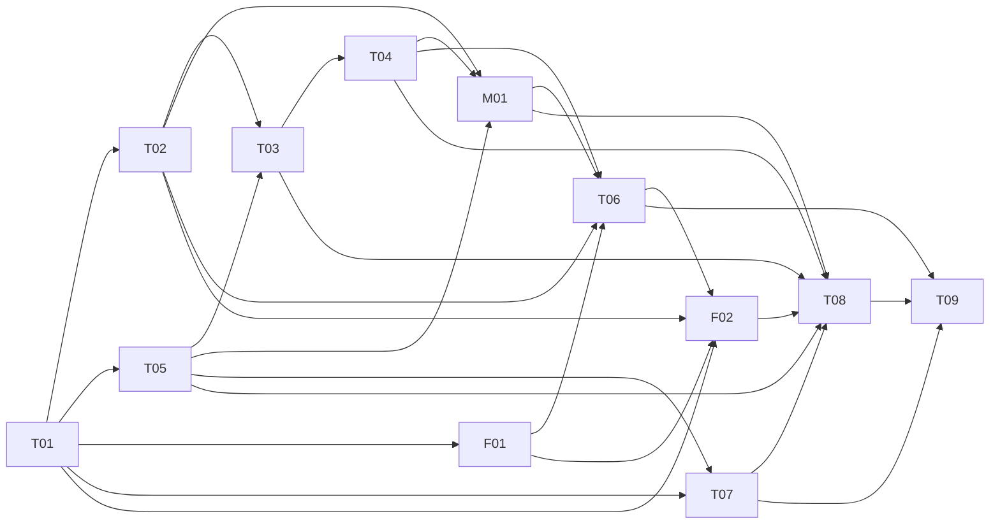

# 媒体流水线开发计划

日期：2026-10-19  
状态：设计待开发；本文件不是实现、部署或真实片源操作授权。  
范围：TaskPaw V3、Miko Library（MDCX304）与 Filmpaw 的跨仓库集成；不承诺排期。

父 EPIC：[#271](https://github.com/AlvinShenSSW/Taskpaw/issues/271)。配套：[架构与契约](2026-10-19-media-workflow-architecture.md)、[EPIC 设计](2026-10-19-media-workflow-epic.md)。

## 1. 目标与已确认部署

操作者持续把影片包放入唯一 Windows 主控的普通本机 INBOX，由后台监听与周期补扫收件；不要求额外投递应用、托管复制器、ready 文件或逐片提交。remote workdir 仅是自动分发的工作副本，不要求向五台机器分别投片或维护五份 input。系统完成 GPU 处理、按需 ASR/字幕翻译后，必须再执行 Miko Library 完整后处理，即便已有 NFO 或封面；最终图文确认展示处理后的成品包。正常流程仅投片与一次“确认入库”，不要求额外 checkbox 或再次确认。确认后才写入选定 NAS 目标。NAS 正式库既有文件绝不自动删除或覆盖。整包目标 hash 校验完成、入库回执持久化且来源复核通过后，系统自动清理对应原始 input 和受控工作副本；失败保留，清理失败只重试清理。

Windows 开发机是唯一主控，运行持久队列、Hub 与本机 1080p Agent；同一壳提供集中页面，但各服务有独立所有权和生命周期。Mac mini 仅同步状态、日志及 OpenClaw/Hermes 所需的只读信息，不持有调度权、领取权、审批权、NAS 写权限或清理权。关闭界面不等于停止常驻服务；停止操作须显式作用于已确认的受管实例。

旧 Hub 的全部普通监控与影片工作流记录一起迁到 Windows，包括设备注册、历史、事件游标、outbox 及已有工作流授权/回执；不只迁五台 GPU 节点。普通监控设备仍为 monitor-only，不因迁移加入执行池。Mac 信息桥读取完整机群的获准状态与日志，不再保留第二个普通监控 Hub 或通知 outbox。

首批五台 LAN Windows GPU Agent 的能力基线（设备目录支持后续动态增删改）：

| 设备类别 | 数量 | 显存/内存 | 允许调度 |
| --- | ---: | --- | --- |
| RTX 5070 Ti | 1 | 16 GB / 32 GB | 4K 或 1080p |
| RTX 5060 Ti | 1 | 16 GB / 32 GB | 4K 或 1080p |
| RTX 5060 | 3 | 8 GB / 32 或 64 GB | 仅 1080p |

主控属于首批三台 1080p Agent 之一，不能按额外第六台计算；这不是设备数量上限。可登记第六台、4090 或其他型号，能力未验证时保持待核验，不能按型号自动放行4K、8K或并发。首批两台16GB优先4K、空闲补1080p，不抢占已开始任务。调度还需本机实际能力探测、资源余量与所有权证明；上表不是官方逐 GPU 参数建议，也不承诺吞吐量。主控可设置 GPU/磁盘并发预算，保证队列与服务不因本机处理被饿死。

Windows 同一 TaskPaw 安装器保留普通安装/升级路径；只有显式启用影片工作流后才选“主控＋Agent”或“计算 Agent”，两者不是所有安装的强制角色；按需下载独立后台运行时与依赖。主控托管独立 Miko/Filmpaw backend 及其数据 owner，用户无需另装或日常打开两个桌面壳；远端仅 Agent 与任务所需 GPU 工具/模型，不含中央数据库或 NAS 写权限。现有 TaskPaw 内新增媒体工作区，旧监控、日志、设置保留。Mac 提供独立轻量 Info Bridge 包，不含完整 UI/GPU/可接管数据库。执行角色变更必须走迁移，不能日常一键切换或静默接管；视图切换不是执行权限变化。以上安装组合是待开发目标，不是现成一键功能。

普通TaskPaw及仅做翻译的机器保持现状：继续原monitor添加、界面、配置和任务，不因本计划安装LTX/Miko/Filmpaw、下载模型或强制工作流配对，也不移除用户已有工具。Hub能监控某设备不代表它已enrolled为worker；发现GPU或翻译HTTP服务不自动授权调度/调用。工作流参与标志与监控注册分离且默认未参与，只有显式启用并核验的节点进入执行池。

输入保留“演员 / 影片 / files”包结构，已有 NFO、SRT 都是受追踪输入。输出保留已配置 NAS 现有 root/演员目录结构，不自动重整正式库。公开文档及 UI 示例只用 NAS-A、NAS-B、NAS-C、NAS-D；调研统计的 16 个 roots、511 个演员目录不转成预填路径、真实演员名单或已验证映射。

## 2. 基线、可复用能力与明确缺口

调查基线：TaskPaw `885ead2`；MDCX304 `fade13561ea247584c8c50847a09f70c66a4b62b`；Filmpaw `acbb1b5de9bc5af9d8434fdb3c6f0246edf4bd13`。TaskPaw 当前 `3fc956b` 与调查基线同 tree `ec5143175432da88c3c6d899b5e26b02874b11dc`，不以不同提交号推断有行为变化。所有“拟新增”路径都是实施定位，不表示已有能力。

| 组件 | 已有源代码入口 | 本计划补齐的边界 |
| --- | --- | --- |
| TaskPaw | `taskpaw_v3/hub/server/store.py`、`poller.py`、`agent/server/admin.py`、`monitors/plugins/jasna.py`、`monitors/subs/job.py`、`core/gpu_lease.py` | 跨机器逐片持久工作流、领取及授权协议、输入/产物身份、恢复核对和归档提交 |
| Miko Library | MDCX304 的 `mdcx/server/launcher.py`、`api/v1/scrape.py`、`tasks.py`、`core/scraper.py`、`core/nfo.py` | 独立 config-dir/staging、影片 UUID 对应、可恢复提交与最终路径结果；现有全局配置、单活动刮削和内存任务不能充当持久总队列 |
| Filmpaw | `app/server/filmpaw_server/routes_performers.py`、`db.py`、`session.py`、`transfer.py`、`routes_archive.py` | 多 NAS 演员位置候选、审批绑定、完整影片包回执及原始 input 清理；不能把现有成品源清理等同于原始 input 清理 |

MDCX304 的 `mdcx-server` 是真实独立后端，无需桌面壳；生产模式需要预构建 Web 静态资源，Python 要求 `>=3.13.4,<3.14`，浏览器依赖另行预检。全局 X-API-KEY 不提供按影片权限，因此不直接交给 GPU 节点或 Mac 桥。刮削固定在 Windows 私有 staging 单进程串行执行。返回 SUCCESS 不能替代逐片 succ/fail 与 counts 判定；改名/失败移动后必须采用实际返回路径。多演员 NFO 主要是姓名，不足以自动建立 Filmpaw 稳定演员身份。

Miko 的 `mdcx/core/image.py:add_mark` 按实际 `has_sub`、`mosaic`、分辨率及既有标识配置处理封面；默认保留旧图和 `*_marked` 状态会跳过重加标识，不能把再次调用刮削等同于封面已刷新。TaskPaw 的 `-破解.mp4` 可命中既有 UMR 规则，但历史 `_restored.mp4`、`.zh.srt` 需适配；空字幕或旧 NFO 标签不证明中文字幕完成。M01 必须在 staging 运行完整元数据、图片、NFO、整理流程，按实际成果复用 Miko 标识，不由 TaskPaw 另造水印。`mdcx/core/file.py:create_folder_jpg` 默认将多视频/分卷目录的最终 poster 复制为 `folder.jpg`（`scraper.py:1128–1130`）；保留父目录和分卷上下文并纳入最终包，不能靠逐个视频调用后碰巧数到兄弟文件。旧图覆盖仅限 staging，正式 NAS 不接受此覆盖行为。

Filmpaw 保留单数据库写入所有者；Windows worker 调用明确的本地适配入口，不让多个组件直接写数据库。当前 macOS 安全提交路径不支持，Mac 桥不承担归档。不得以 README 计划、静态原型或路由存在声称端到端能力已经实现。

### 2.1 现有壳、后台打包与待补能力

TaskPaw 的 taskpaw_v3/ui/src/App.tsx、views/AgentConsole.tsx 与 views/HubDashboard.tsx 已有角色及监控/日志入口，scripts/build.py 当前构建单一 TaskPaw backend + Tauri；需新增媒体工作区和多组件生命周期，不能把开发角色 tab 当已交付组合主控。MDCX304 的 scripts/mdcx-server.spec 和构建 workflow、Filmpaw 的 app/server/build_sidecar.py 与 app/server/filmpaw_server/main.py 均提供可复用后台产物基础；后者的端口/PID输出早于服务就绪，须另核健康/版本/schema。运行时分别按各仓库版本构建，不能假定三者共用同一Python环境。

Filmpaw app/server/filmpaw_server/app.py 与 session.py 实际持有library_session独占库锁；已有库接管必须保留IDs/映射/journal且阻断第二writer，未选择库不得写默认生产路径。TaskPaw taskpaw_v3/hub/server/store.py 的现有 remove_server 会删除关联status/events/outbox，新工作流必须另用retire/tombstone保留证据，不能复用破坏历史的删除语义。统一发现/安装/更新/回退、依赖分发、干净机安装尚未验收，列入T05/T09而非宣称已可用。

## 3. 先冻结的共用契约

以下约束适用于全部子 issue；具体协议在 T01 形成带版本 schema 和契约测试，后续 issue 不各造一套状态机。

1. **影片身份与包版本**：`film_id` 为不可变 UUID；`manifest_revision` 单调递增。包内每个成员有稳定 `artifact_id`、相对路径、角色、大小、hash、来源绑定与必要的卷序。原始 input 的身份/hash 与处理后产物分开记录；番号、标题、演员名和路径均不能替代 UUID。
2. **操作性收件准入**：默认普通本机 INBOX 采用监听加周期补扫；后台结合稳定窗口、完整成员集合、写占用检查、媒体探测及完整读取 hash，冻结不可变 input snapshot，并核对受控工作副本后进入 `operational_ready`。协议如沿用 `intake_verified` 字段，仅代表此操作性准入，不是生产者复制事务完成证明；无发送端 owner、ready 或原子 commit 的默认交付依赖。持续写入/成员变化保持收件中，探测失败或证据未知进入异常。长期静止的中断复制仍可能通过这些检查，未来迟到文件也无法由目录观察排除；这是明确的技术假设，须用原生故障测试记录局限，不能声称绝对完整或另加逐片 checkbox。发现身份/内容/成员变化时使相关快照、审批或清理资格失效，不能清理新文件。
3. **多文件语义**：一影片可含多个视频分卷，每卷有明确顺序和对应字幕；不可靠的自动分卷/字幕匹配须人工修正。同目录多个不同影片不得无条件合并，拆分时保留父目录、成员与目录封面归属；有歧义先人工处理。已有 SRT 按语言、可解析性与显式策略决定复用/翻译/按需 ASR；已有 NFO 保留原件与字段来源，但不能跳过修复/字幕后的 Miko 完整后处理。多演员不自动生成多份 NAS 副本，默认先选一个确认后的归档位置并保留全部演员元数据。
4. **阶段状态与所有权**：持久化 stage、attempt、owner、generation/fencing token、lease、输入/输出摘要和错误分类。领取/续租/完成使用条件更新；旧 attempt 不得提交结果。失联不等于进程已停，租约到期不自动证明可重派或释放 GPU。GPU 槽位只等待 LTX/ASR 受管进程停止/清理证明，不等待后续 NAS 归档和 input 清理。等待核对的 unknown 是独立状态。
5. **网络边界**：保留 `/ping`、`/status`、`/events` 及 event-id 合约；新工作流能力为版本化增量。Agent 主动向认证的 LAN 主控领取类型化任务，现有 loopback admin 控制面不开放到 LAN。凭据仅在受保护本地配置/环境，公开文档、命令参数、日志及 Mac 桥不包含秘密。
6. **批准与失效**：最终页展示 Miko 处理后的图片/NFO/字幕及适用的 `folder.jpg`、完整包、目标和自动清理范围，一次“确认入库”生成版本化批准；没有附加逐项 checkbox 或第二次确认。审批绑定 film_id、manifest_revision/完整包摘要、元数据版本、候选索引版本、明确 NAS/root 身份、相对目标、input snapshot 与精确来源清理范围。任何绑定变化使批准失效，须重新确认。重复点击和网络重放用请求键处理，不靠 UI 禁按钮保证。
7. **归档与未知结果**：写入前验证目标身份/容量/权限/冲突。只创建新的获批影片包；既有正式文件不覆盖、不删除。分段/部分落盘、超时或断网先记录 unknown 并核对本次操作的 receipt 与文件证据；没有证明不得重传、清源或报告成功。重复版本/同名多库要明确复用已有回执、换目标或保留跳过，不自动猜测。
8. **清理门槛**：整包目标 hash 已核对且 durable archive receipt 已持久化，才分别自动清理清单绑定、明确指定 INBOX 内的最初片源与受控工作副本；不授权删除任意外部投递原件。普通目录输入符合条件时正常自动清理，不因缺少生产者 commit 而永久保留。执行前将来源原生身份、内容 hash、包成员集合、写占用及归属与审批 snapshot 复核；删除必须绑定同一已验证原生对象句柄或等价排他身份，禁止检查后重新按路径 unlink。校验后删除前替换来源或切换父目录也不能误删；真实变化、仍写入、证据未知或无法原子绑定安全删除时，受影响 input 保留 `cleanup_pending`。已归档结果和 receipt 保留，独立合格的受控副本可按自己的授权清理。NAS 正式库、整个共享目录/演员目录、未知链接目标不属于清理范围；归档后清理失败只重试清理，不再次处理或上传。
9. **异常处置**：每阶段提供有条件重试、跳过并保留 input、人工处理入口。权限错误先修复授权；未知副作用先核对；取消/停止先证明受管进程和文件写入已收束。跳过不伪造阶段成功，不绕过完整包校验/最终批准/归档回执等强制门槛。
10. **真实性**：处理 ETA、当前阶段、错误与采样时间来自真实证据；未知/过期明确显示。不把轮询成功当作新采样、不把同机有空闲进程当成 GPU 可用、不把总体任务 SUCCESS 当作每影片完成。

T03/T04 的 GPU 准入范围包括 LTX、ASR、同 GPU 的本地翻译模型（即使经 HTTP 调用）与已登记手动任务。无法核对的外部占用阻断该卡自动准入，不能杀无关进程腾资源；远端翻译另设并发限额。未证明受管进程树及关联 I/O owner 收束时，保留 owner 并拒绝第二个 GPU 任务。

T08/F01/F02 的 UNC 探测、索引、复制、hash 和清理须在受管隔离子进程执行，限制每主机同时在途数、重试退避与熔断。线程超时不证明子进程树/句柄/I/O owner 已结束；退出未证明时保留 owner 并隔离操作，不不断创建新进程。其他 NAS、主控 API 和 UI 仍应可用；熔断恢复先核对旧 operation，再准入新写入。

### 3.1 T03：动态设备目录与生命周期

新增设备时收集显示名称、LAN 主机名/IP、Agent 监听地址/端口、配对材料及声明的 GPU 型号/数量/显存、系统内存。配对后自动读取 Agent 身份、OS/架构、GPU 标识与实测显存、驱动、可用工具/模型/profile、磁盘余量和传输连通性。网络地址可以变化，`device_id` 不随 IP/名称重建；地址不作为信任凭据。

登记流程区分草稿、待配对、待核验、可调度、停领/排空、停用、待退役与 tombstone。配对材料有明确时效/单次使用/作用域，不在日志公开。不能通过未认证硬件响应启用设备，不能自动扫描 WAN、使用 SSH/共享管理员凭据或下发任意命令。

手填信息与探测结果冲突时展示两者及证据时间，默认阻断不符能力的领取；未探明能力不默认视作1080p/4K可用。手动设置可以收紧能力，不可不经验证提高能力上限。首批三台8GB仅1080p、两台16GB优先4K的限制保留；未来设备依有证据的 capability/profile准入，不写死为五种列表行。

编辑名称仅改变展示。修改地址、凭据或资源上限须生成配置版本并重新核验，不能把旧 attempt 归属转给新地址；运行中的任务保留原绑定。停领/排空拒绝新 claim，允许已领任务按契约完成；停止是独立显式操作。停用与移除不等于证明进程已经结束。

移除使用**retire/tombstone**流程，隔离现有 `remove_server`：有 active/unknown owner、未核对副作用或未归属回传时阻断最终移除；可先停领并撤销执行凭据，仍保留未决记录。最终退役撤销所有旧 token/generation，保留 device_id、assignment、receipt、历史、event cursors和outbox，不能删除历史制造“空闲”。重登记不能回收旧 ID 或接纳旧 token。未决任务只能经新的可信核对通道解决，不能为退役跳过所有权证明。

验收至少覆盖增删改、重复配对、重复地址/不同身份、地址变更、硬件声明冲突、显存/模型/磁盘不足、停领期间完成、离线unknown退役阻断、撤销token晚到消息，以及退役后receipt/outbox/cursors仍完整。

### 3.2 T05：普通安装与可选工作流角色

普通安装/升级首先保留现有功能，只有显式选择启用影片工作流才进入以下角色配置。主控工作流安装目标在现有 TaskPaw 中增加工作区与后台组件管理，不要求日常单独启动 Miko/Filmpaw 桌面壳。它安装/发现并管理：

- TaskPaw Hub 与本机 Agent 的独立服务角色、配置与端口；
- Miko 的独立后台组件、私有 config-dir/staging、资源和浏览器依赖预检；
- Filmpaw 的独立后台组件、唯一数据库所有者和归档凭据；
- 兼容性清单、实际版本/健康状态、受管日志与可审计的更新/回退操作。

同一 Windows 安装器的“计算 Agent”角色只负责本地 Agent、配对/诊断入口，以及任务需要的 GPU 工具/模型依赖检测和安装引导；不部署中央 Hub、Miko、Filmpaw 或 NAS 写凭据。组件可按需下载独立运行时，不要求把所有依赖塞进一个 EXE。用户可以复用已验证的既有 GPU 工具，不能仅按目录存在认定版本可用。驱动/模型大文件的下载、权限、完整性与许可由明确步骤处理，不能隐藏为“Agent 已装所以全部可运行”。

安装后的角色变更必须经过迁移预检、停领/归属核对、数据和凭据切换；不能以日常 UI 下拉框静默把计算节点升为第二主控，或把仍拥有任务的主控降级后遗忘队列。沿现有 #52 客户端视图切换不等于改变机器执行角色。

只有显式选择影片工作流的两种Windows角色才通过首次向导完成所需目录、配对、工具/模型下载确认和预检，再由操作者显式启用。启用后系统自动建立唯一的工作流执行配置与任务观测，派发影片自动呈现；主控或remote都不再要求手工添加Jasna监控或新增监控类型。主控只有一个人工INBOX，remote目录只是自动工作区。未通过预检、取消或未启用时不执行。重复向导、重新配对、重启需幂等，不能为同一worker/workflow建立第二执行实例。旧手动添加监控保留，升级不启动旧任务、不静默启用工作流或接管已有手动配置；所有自动/手动GPU阶段共用同一本地owner。

组件发现要区分“本安装器拥有的实例”和“用户已有安装”。现有服务/桌面实例正在占用 Filmpaw DB 时，不启动第二 owner、不删除锁、不杀陌生进程；提供显式连接/停机迁移的选择。只有版本/契约、数据库 schema、来源/目录归属和凭据边界通过验证才能接入；失败保留旧安装和数据。

版本清单同时记录各组件 binary/build、API/schema、数据库迁移范围及依赖。更新先停新领取并核对在途工作，暂存完整性验证新组件，完成所需备份及迁移演练，再切换受管入口并健康检查；不能仅因进程/端口输出存在判为成功。原生所有权/unknown 未收束则阻断会破坏证据的升级。

回退必须同时考虑二进制和已变更的数据。只允许演练过的兼容回退或保留 receipt 的一致性恢复，不自动向旧 schema 写新状态，不用回滚数据库遗忘已发生的 NAS 提交。卸载/移除组件默认保留用户 DB、配置、收件及回执；删除用户数据需要不同的显式动作，不在本安装目标内。

服务托管选择和停止语义继续复用 #52/#225/#237，不能因此把现有 owned-backend 桌面关窗语义静默改变。新增工作流设备退役不得复用 `remove_server`；安装卸载和迁移也不得借该接口清空历史/outbox/cursors。

Hub 迁移的集合必须覆盖所有普通及工作流设备注册、监控配置引用、历史、事件游标、outbox 和新增 workflow/receipt，不以 worker enrollment 过滤。迁移演练用混合 monitor-only/翻译/影片 worker 数据核对数量、身份、游标连续性和通知去重；执行参与标志保持原值。旧 Mac Hub 的普通轮询和通知发送也要停止/隔离，不能一边迁影片一边留普通双 Hub。

### 3.3 T06：现有 TaskPaw 内的工作区及远端体验

保留现有监控/日志入口和用户配置，媒体工作区是同一 TaskPaw 壳中的新增导航域；九页不是替换旧产品的整个菜单。默认页/最近工作区可记忆，但升级不启动原先停用的手动任务，也不自动把旧监控条目变成可执行 workflow worker。

设备页支持添加、编辑、核验、停领/排空、停用、退役；表单展示网络与硬件声明，旁边列出探测证据和冲突。移除弹窗准确说明保留历史、撤销凭据及阻断原因，不提供“强制忘记unknown任务”快捷方式。

远端 Agent 的最小 UI 包括主控配对、网络/工具/模型/GPU预检、当前任务/归属、停领/排空和本机日志。主控离线时明确显示旧快照及在途任务处理规则；没有NAS/审批/清源入口。单个Agent不需要打开完整主控工作区或Miko/Filmpaw界面。

本机与远端视图共用同一注册池的设备身份、停领/排空、owner和容量；不能因切换视图复制节点或增加GPU槽。无profile可保存pending_validation但不可领取；离线unknown可撤销未来claim，仍保留未决归属并阻断退休。

主控组件状态在本机/设置页展示实际发现版本、兼容/健康、DB owner、依赖缺失和迁移/更新影响。按钮行为按真正实现的后端能力开放；不能用“安装成功”占位掩盖未部署依赖。

### 3.4 T07：独立 Mac Info Bridge 包

Mac 安装包仅分发轻量后台桥、最少运行依赖、配置/诊断和有界快照/日志文件；不带完整 TaskPaw Web UI、GPU/模型、Miko/Filmpaw 或可接管队列。它消费 Windows 上全部已授权普通监控与 workflow 状态，不仅是五台 GPU 任务；仍使用只读身份和既定 cursor/gap/reset、两层时间、唯一通知 outbox 契约。需要新增真正的轻量打包/服务托管/更新回退验证；目前源码入口存在或在 Mac 可运行 Python 不能证明这个独立包已经交付。升级失败保留已标龄快照与消费游标，禁止降级成全权 token 或第二主控。

普通监控注册不等于worker enrollment；T01另存默认关闭的workflow_participation和执行授权。T03只调度明确参与、配对并验证的worker，不能用Hub监控列表或发现的翻译服务自动扩大执行池。

T01 持久契约同时保存 enrollment/配对消费、worker/device ID、boot ID、地址与能力revision、声明/探测/批准能力的独立证据、token撤销及retire/tombstone。普通重启保留worker ID并先核对；退役后重入使用新ID/凭据，但同物理GPU的旧unknown owner未收束时仍不得启动冲突计算。此规则由T01/T03/T08/T09共同验收，不能用换IP、重新安装或新建节点清掉旧归属。

## 4. 子 issue 与依赖 DAG

所有子 issue 状态均为“设计待开发”。依赖 key 用于跨仓库发布后回填实际 issue 链接；不预造 issue 编号。

| Key | 仓库 | 可独立验收的交付 |
| --- | --- | --- |
| T01 | Taskpaw | 持久状态机、manifest/attempt/审批/receipt与设备enrollment/tombstone契约 |
| T02 | Taskpaw | 普通本机INBOX持续收件、操作性准入、快照清单与修订/重复检测 |
| T03 | Taskpaw | 动态设备登记/退役、能力调度、领取/失联归属与GPU释放门槛 |
| T04 | Taskpaw | 逐片 LTX/ASR/字幕适配及完整产物回传 |
| T05 | Taskpaw | 统一Windows安装器两角色、后台组件托管、独立服务及旧Hub/已有组件迁移 |
| T06 | Taskpaw | 现有TaskPaw媒体工作区、动态设备/远端UX、图文确认与异常 |
| T07 | Taskpaw | 独立Mac轻量Info Bridge包、只读同步及OpenClaw/Hermes消费契约 |
| T08 | Taskpaw | 跨组件恢复、错误分类、重试与 unknown 核对 |
| T09 | Taskpaw | 安装/更新/动态节点及合成包到首批五机的灰度与回滚 |
| M01 | MDCX304 | 隔离 headless 完整后处理、真实成果标识/目录封面及最终路径结果 |
| F01 | Filmpaw | 多 NAS 演员位置索引与只读目标候选 |
| F02 | Filmpaw | 已批准影片包安全归档、持久回执及精确来源清理 |

DAG 展示主要依赖边，下表完整列出与 issue 草稿 `dependency_keys` 相同的前置（含为单独阅读保留的传递边）。不阻止 schema 冻结后并行开发 mock/契约测试。T06 可先按冻结原型开发；涉及真实批准/归档按钮须等依赖验收。F02 的审批消费 schema 在 T01 冻结，T06 的生产审批实现是 F02 集成验收前置，避免 UI 和归档后端互相等待。

| Key | 完整前置 key | 前置交付含义 |
| --- | --- | --- |
| T01 | 无 | 独立设计审阅通过，先冻结公共 schema |
| T02 | T01 | input snapshot、成员身份和 revision 契约 |
| T05 | T01 | 服务身份、迁移数据与权限契约；W1先交付生命周期/安装骨架，具体组件的完整链路留W3/W5验证 |
| F01 | T01 | 候选/root身份与索引版本契约 |
| T03 | T01、T02、T05 | 已准入包及T05 W1服务/身份基础；不等待T05 W5整包迁移结束才开发 |
| T04 | T01、T02、T03 | 有效owner与输入/产物契约 |
| M01 | T01、T02、T04、T05 | T04真实成果交接、T05隔离backend基础；可先用冻结fixture开发，最终验收必须消费T04产物 |
| T06 | T01、T02、T04、M01、F01 | 完整后处理成品与可解释目标候选；普通界面/设备表单可先行 |
| T07 | T01、T05 | 全部Hub记录迁移与唯一权威的只读导出基础 |
| F02 | T01、T02、F01、T06 | 审批绑定的Miko最终包及input snapshot；M01经T06传递，不另造后处理旁路 |
| T08 | T01、T03、T04、T05、T07、M01、F02 | 各适配器实际恢复证据；W1可先冻结故障分类，W5收口集成 |
| T09 | T01、T02、T03、T04、T05、T06、T07、T08、M01、F01、F02 | 全部实现与恢复门槛后才开展逐级授权灰度 |

既有 issue 必须复用：

| 既有 issue | 本计划关系 | 完成门槛 |
| --- | --- | --- |
| [#52](https://github.com/AlvinShenSSW/Taskpaw/issues/52) Hub connect-only 客户端 | T05 复用其只读连接和关窗不停止 Hub 的基础；本计划本地审批/控制是另有鉴权的增量，不把 #52 改成远程控制 | T05 真机生命周期验收前需核实其交付 |
| [#225](https://github.com/AlvinShenSSW/Taskpaw/issues/225) 受管进程/GPU 所有权 | T03/T04/T08 消费其停止与清理证据，不重造泛化进程框架 | 真实 GPU 接入/重派前通过对应 Windows 所有权测试 |
| [#237](https://github.com/AlvinShenSSW/Taskpaw/issues/237) 常驻服务、备份与恢复 | T05 扩展其清单纳入工作流状态，不另开重复服务运维 issue | 常驻与迁移可操作交付前核实模板、备份和恢复 |
| [#236](https://github.com/AlvinShenSSW/Taskpaw/issues/236) 采样新鲜度 | T06/T07 复用其时间/错误/证据语义 | 实时/过期状态上线前完成兼容契约 |
| [#234](https://github.com/AlvinShenSSW/Taskpaw/issues/234) 有界事件重放 | T07消费其重放基础并补桥接cursor/gap/reset | 只读桥事件同步验收前核实重放与缺口语义 |
| [#233](https://github.com/AlvinShenSSW/Taskpaw/issues/233) 通知健康 | T07沿Windows唯一outbox权威，不在Mac重复派告警 | 通知链路与恢复验收前核实健康/去重证据 |
| [#232](https://github.com/AlvinShenSSW/Taskpaw/issues/232) Hub有界并发 | T03消费轮询/并发预算，保证调度不饿死普通监控 | 负载与失联场景验收前核实容量边界 |
| [#240](https://github.com/AlvinShenSSW/Taskpaw/issues/240) 跨机验证 | T09复用其跨机原生矩阵与证据 | 实机灰度前核实对应平台门槛 |

以上四项在本次调查仍为 open，不能因本文引用而视作已修复。其各自前置依赖仍有效；实施时由 driver 核对最新状态和验收证据，禁止通过修改本表跳过原有门禁。

## 5. 开发波次与退出标准

| 波次 | 工作与可交付内容 | 退出标准 / 此时能做什么 |
| --- | --- | --- |
| W0 设计冻结 | 三仓库契约、架构、UI v3原型、12 个子 issue；保留Kimi审阅记录并按用户要求进行FABLE整包外审 | 所有 blocker 有裁决，关切有明确处置；状态/审批/清理/部署口径一致；仅可开始开发，不可操作真实片源 |
| W1 持久控制基础 | T01含设备enrollment/tombstone；T05统一安装角色/组件清单/本机连接骨架，衔接#52/#237；T08故障分类 | 临时DB重启保留包/attempt/设备与授权历史；无双主；安装角色与视图分开；仍禁真实处理/NAS写入 |
| W2 收件与候选 | T02唯一普通本机INBOX监听+补扫、F01；T06原有工作区共存及设备表单 | 稳定/写占用/媒体probe/一致hash快照准入可验证并说明局限；多卷/NFO/SRT、同名/多库/旧索引通过；无额外投递器/ready要求；可看队列但不能上传 |
| W3 单节点全处理 | T03单节点到动态领取、T04、M01；计算Agent安装角色与T05/#225门槛 | 受控Windows处理/回传后必经Miko完整后处理；旧图正确刷新、字幕真实标识及folder.jpg归组通过；remote无人工input；UUID及停止归属可证明 |
| W4 确认与测试库归档 | T06完整工作区/审批、F02、T07独立Mac包 | 一次确认无checkbox→整包校验→receipt→来源复核通过自动清理普通input；变化/仍写/未知保留待清理；Mac包仅只读 |
| W5 恢复与服务化 | T08；T05已有组件/全部普通+workflow Hub迁移、更新回退；T07全机群只读恢复；动态退役/重入 | unknown先核对；cleanup-only；无双主/双DBwriter；全部历史/outbox/cursors与membership保留；新身份不绕过物理GPU旧owner |
| W6 真实灰度 | T09：干净机两安装角色/Mac包；一台1080p→两台→首批五台，另加受控第六节点登记；测试NAS→获准目标 | 逐级通过完整链路、安装更新/回滚及动态节点门槛；实机与模拟证据分开，不宣称现场已有第六台机器 |

波次没有日期承诺。遇到依赖未完成时交付可验证的模拟/隔离结果，并明确未开放能力，不用按钮占位或“即将支持”冒充可操作闭环。正式部署、迁移和真实片源演练是之后另行执行的操作阶段，本设计交付不执行它们。

## 6. UI 页面到工作包

原型：`design-system/taskpaw-v3/preview/media-workflow-v3.html`；页面规范：`design-system/taskpaw-v3/pages/media-workflow.md`。原型数据均为虚构，不能连接真实服务。

| 页面 / 原型锚点 | 主要 issue | 退出标准 |
| --- | --- | --- |
| 概览 / `#overview` | T01、T03、T06、T08 | 有真实阶段/数量来源；unknown、过期、待清理不计作完成 |
| 影片队列 / `#queue` | T02、T03、T04、T06 | 操作性准入证据与包 revision 可查；按 film_id 查看分卷/阶段，而非用当前路径作身份 |
| 待确认 / `#review` | T06、M01、F01、F02 | Miko最终图文、NFO/字幕、适用folder.jpg、包/目标/清理范围同屏；一次确认无checkbox，绑定变化后批准失效 |
| 异常 / `#exceptions` | T06、T08 | 每阶段合法动作清晰；unknown 先核对、权限先修复、cleanup_pending 仅清理 |
| 设备 / `#devices` | T03、T06 | 动态添加/编辑/探测/排空/退役；声明与证据分开；首批8GB不领4K，unknown阻断移除 |
| 本机 / `#local` | T05、T06 | 实际组件/版本/单DBowner/依赖状态可见；保留旧监控日志，关窗不误停常驻服务 |
| 片库与规则 / `#libraries` | T02、F01、T06 | 多 NAS/root 候选、重名/多演员决策与索引时间明确；不自动重整正式目录 |
| Mac 信息桥 / `#bridge` | T07、T06 | 全部普通+workflow获准状态的只读同步与离线证据；无执行/批准/清源按钮 |
| 设置 / 迁移 / `#settings` | T02、T05、T09 | 普通本机INBOX、安装角色/版本、全部Hub监控迁移与已有组件回退明确；不是日常一键换执行角色 |
| 共用影片详情抽屉 + 批准弹窗 | T01、T04、M01、F02、T06、T08 | 展示全阶段、attempt、包 revision、原 input 与产物的关系；每次批准均可审计 |

九页属于显式可选的媒体工作区，不替代或遮挡普通安装的旧监控/日志/设置；仅翻译机器无需工作流向导、模型下载或配对。remote Agent只提供配对、依赖预检、当前任务/owner、停领排空与本机日志，无审批/NAS操作；完整主控组件安装/角色迁移只能通过受控流程。

T07 必须补齐真实的只读同步协议：现有 recent/limit 事件查询不是 after 游标流，需要稳定 cursor、gap/reset 和恢复规则；源采样时间与桥接收时间分别保留。原始任务日志目前位于本地，需要新增有界、脱敏的增量导出。Windows 是唯一通知 outbox 权威，Mac 不重建第二 outbox 或重新派送同一告警。

## 7. 实施文件定位与写入边界

| 工作包 | 现有入口 / 拟新增定位 | 预期写入 |
| --- | --- | --- |
| T01/T02/T03/T08 | `taskpaw_v3/hub/server/store.py`、`poller.py`、`agent/server/app.py`；拟新增 `taskpaw_v3/workflow/` | 有版本的工作流 DB/schema、来源清单、任务 attempt 与回执引用；不能写 NAS 正式库 |
| T04 | `taskpaw_v3/monitors/plugins/jasna.py`、`taskpaw_v3/monitors/subs/job.py`、`taskpaw_v3/monitors/subs/existing.py`、`taskpaw_v3/core/gpu_lease.py`；拟新增 workflow adapter | 仅当前影片受控工作目录、完整产物清单；原 input 不作为可覆盖输出 |
| T05/T06 | `taskpaw_v3/src-tauri/src/main.rs`、`startup.rs`、`core/control.py`、`agent/server/service.py`、`hub/server/service.py`、`ui/src/App.tsx`、`ui/src/views/` | 本地角色/连接配置、明确授权的迁移副本；实际服务注册属于后续执行 |
| T07 | `taskpaw_v3/hub/server/status_md.py`、`openclaw.py`；拟新增只读桥导出模块 | 脱敏快照/有限日志与消费游标；禁止回传命令 |
| M01 | MDCX304 的 `mdcx/server/launcher.py`、`mdcx/server/api/v1/scrape.py`、`mdcx/server/tasks.py`、`mdcx/core/scraper.py`、`core/image.py`、`core/file.py`、`config/models.py`；拟新增适配契约测试 | 私有 config-dir、staging 与完整后处理/封面/目录封面结果；不写原 input 或 NAS |
| F01/F02 | Filmpaw 的 `app/server/filmpaw_server/routes_performers.py`、`db.py`、`session.py`、`routes_archive.py`、`transfer.py` | F01 只读目录索引/本地缓存；F02 仅获批新目标、durable receipt 与逐项许可的来源清理 |

跨仓库实现必须分别遵守其 AGENTS/constitution；本计划不授权当前阶段修改实现。运行协议/CLI 尚需 T01/M01/F02 冻结时给出准确版本、输入、输出和退出语义，不能现在虚构已存在的 pipeline CLI。现有开发检查入口沿各仓库规定执行；TaskPaw 用 `uv run pytest`、Ruff、mypy、UI lint/test/build，以及影响壳时的 Rust 测试。测试/迁移工具只操作显式拥有的临时目录，不接触真实配置、秘密或 NAS。

## 8. 验收矩阵、风险与回退

| 故障/边界 | 必须证明 | 负责 key |
| --- | --- | --- |
| 正在写入、暂停/中断复制、分卷/NFO/SRT迟到变化 | 检出写占用/变化时不准入；稳定后完成probe/hash与工作副本核验；明确静止中断复制无法排除的局限，变化使旧快照/批准/清理失效 | T02、T06、T09 |
| 两节点争领、主控重启、Agent 失联/旧回执 | 只有当前 owner 可推进；失联先核对；受管 LTX/ASR 停止证明前不释放 GPU | T01、T03、T08 |
| LTX/ASR 子进程残留、输出不完整、回传中断 | 可见失败/unknown；完整产物校验通过前不进入刮削/归档 | T04、#225、T08 |
| 同 GPU 本地翻译 HTTP 服务/手动任务与 LTX/ASR 竞争 | 同一资源准入；未知外部占用不抢占，原生停止/I/O owner 未收束不释放 GPU | T03、T04、#225 |
| 刮削改名、失败移动、整体 SUCCESS 含单片失败 | UUID 连续且最终路径来自回报；失败保留工作包 | M01、T08 |
| 已有NFO/旧封面、错误标识、.zh.srt/空字幕、多视频目录 | 仍跑完整Miko后处理；真实成果决定现有标识且重试不叠印；folder.jpg与最终poster一致并入manifest，失败不凭总体SUCCESS放行 | T04、M01、T06、F02 |
| 多演员、同名演员、多 NAS、重复版本 | 有可解释候选与人工决定；无自动多份归档或覆盖 | F01、T06、F02 |
| 批准后包/目标/权限改变 | 旧批准被拒绝；权限错误不盲重试 | T01、T06、F02 |
| NAS 写一半、超时但可能提交、receipt 丢响应 | unknown→核对；不盲重传/清源，正式旧文件不变 | F02、T08 |
| UNC 阻塞、NAS 冷启动、子进程无法确认终止 | 隔离子进程与 owner 数有界、每主机退避/熔断；其他 NAS/API/UI 可用，恢复先核对旧操作 | T08、F01、F02 |
| 已入库但 input/缓存清理失败、校验后删除前源被替换 | durable receipt 保留；同一已验证句柄或等价排他绑定删除；否则 cleanup_pending，替换文件不删 | F02、T08 |
| 普通INBOX已稳定且归档后源未变 | 同native身份/内容/成员/写占用复核通过即自动精确清理；无额外ready/checkbox，也不按普通目录类别永久保留；变化只阻断受影响input | T02、T06、F02、T08、T09 |
| 窗口关闭、睡眠、服务重启、Hub 迁移失败 | 独立生命周期；无双主；旧数据可恢复 | T05、#52、#237、T09 |
| 全部普通+workflow Hub迁移与Mac只读 | 普通监控/翻译节点、history/cursors/outbox与workflow/receipt齐全；membership不扩大，旧Mac不再轮询/派告警，全机群由Windows权威导出 | T05、T07、T09 |
| 统一安装、已有组件/Filmpaw库、版本更新/回退 | 主控两后台无独立GUI可用；单writer、版本/schema/真实ready；保留IDs/journal/receipt，未选库不写默认生产路径 | T05、M01、F02、T08、T09 |
| 动态新增/探测冲突/退役/重入 | 声明与实测分开；unknown不遗忘；旧token拒绝、history/outbox/cursors保留；新ID不绕过物理GPU旧owner | T01、T03、T06、T08、T09 |
| 普通安装/仅翻译Agent升级与混合设备 | 原monitor添加/配置/任务保留；不安装工作流组件、不强制配对；Hub可监控/发现翻译服务不等于获得执行资格 | T01、T03、T05、T06、T09 |
| 首次向导与自动任务观测 | 两角色显式启用后无需手动添加Jasna/新监控；重跑向导不双建执行配置，升级不启动旧任务，GPU统一owner | T04、T05、T06 |
| 单中央INBOX与现有工作区共存 | remote目录不是第二投片入口；旧监控日志保留；视图不改变机器执行角色 | T02、T05、T06、T09 |
| Mac 断线/重放/被错误配置 | 状态过期可见；无法领取、批准、上传或清源 | T07、#236 |

主要风险是跨组件副作用不可被一个 DB 事务覆盖，而非 UI 是否能显示流程。采用持久 attempt、条件更新、幂等请求键、目标回执和恢复核对；不宣称跨机器 exactly-once。MDCX/Filmpaw 原生进程、浏览器、Windows 文件身份与 NAS 提交语义必须用原生受控集成测试和授权实机演练补足，mock 不能替代。

回退先停止新收件/领取，保留正在执行任务的归属与核对状态，等待或明确终止受管工作，再回退服务和已验证兼容的数据快照。不得通过删除正式 NAS 文件“回滚”；已有 durable receipt 保留并防重复上传/清理。数据库向后不兼容时只允许已演练的恢复路径，不能让旧版本误读新状态继续派发。

## 9. 交付验收与移交

设计交付包括主 EPIC、架构、本文、静态 UI/UX v3原型和 12 个子 issue 草案；保留独立 Kimi 审阅记录，并按用户要求增加 FABLE 对本次修订整包的外审。任何尚未完成的审阅不写成通过；审核通过仅表示可以按波次开始开发。

每个子 issue 关闭必须提供：实际实现提交、契约/行为测试、适用平台原生证据、未验证项、运行/恢复说明及 UI 对应入口。端到端发布门槛由 T09 收口：真实图文确认与安全归档/清理可操作、首批五机与动态节点调度不越能力、统一安装/更新可验证、Mac轻包只读、主控唯一、NAS 既有库不被改删。任一未验证门槛保留为待完成，不以“代码存在”或“设计已审”代替。

