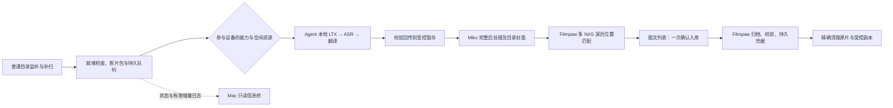

# EPIC：持续影片流水线与多机协同调度

日期：2026-10-19。状态：设计稿，待开发。独立审阅与子任务进度见 [EPIC #271](https://github.com/AlvinShenSSW/Taskpaw/issues/271)。Kimi K3 已审过前一版；本版纳入后续用户澄清，交 Fable 整包审阅。此次只交付设计与 issues；不启动开发或迁移。

## 1. 产品决定

在现有 TaskPaw V3 中增加“影片工作流”工作区，以 TaskPaw 为唯一操作入口和总调度，复用 Miko Library 的刮削引擎与 Filmpaw 的演员库、NAS 路由和归档能力。保留现有任务、监控、日志、设置与 Hub 集群功能；媒体页面属于新增工作区，不是另一套独立应用。三个项目各自保留职责，由版本化适配接口串联。

Windows 使用同一个 TaskPaw 安装流程，并保留普通 TaskPaw 的安装与使用路径。只有选择启用影片工作流时，才准备“主控＋Agent”或“计算 Agent”角色；不参与工作流的机器继续使用现有监控、日志、设置和手动添加监控，不安装 Jasna/LTX、Miko、Filmpaw，也不被自动改造成计算节点。普通翻译机已有用途和配置保留。Hub 中可监控的机器不等于已授权的影片 worker，发现翻译服务也不构成调用授权。

主控安装流程部署并管理 Miko、Filmpaw 所需后台组件，用户无需另外安装或打开两个桌面壳；内部仍是版本独立、数据归属明确的后台进程，可以按需下载各自运行资源，不承诺把三套运行时揉进一个 EXE。现有源码已有独立后台构建入口，但统一安装、升级、回退与旧数据交接仍需本 EPIC 实现和验证。原 Mac Hub 的迁移目标使用单独的轻量信息桥包；不要求其他普通 Mac Agent 一并变更用途。

参与工作流后的首次向导负责建立所需执行配置与任务观测：主控设置收件/片库与本机模型，远端完成配对、硬件与模型准备；必要下载在界面确认，检查通过并明确启用后即可自动接片。参与的主控和远端均无需再手工“添加 Jasna 监控”或另加一种工作流监控。系统派发的影片自动呈现进度与日志，保留现有“添加监控”供手动任务使用。升级不自动启用工作流或启动旧任务；同一任务与 GPU 使用统一身份和所有权，不能因重复添加监控产生第二次执行。

日常正常路径只有两次人工动作：把新影片放入本机普通收件目录；在图文列表核对影片、演员和目标片库后点击一次“确认入库”。不要求额外投递器、逐片 ready 提交或技术风险复选框。后台通过文件变化监听与定期补扫发现新包，等待稳定并检查写入状态、媒体可读性和一致快照，再按影片派给合适的空闲设备。中间自动完成 LTX、字幕、回传、Miko 完整后处理与候选匹配。真实异常只给简短原因及可用的重试、跳过、打开文件夹/人工接管动作。所有“完成”都必须有可恢复的阶段结果，不能由 UI 的 100% 推断。

Windows 本机是唯一 Hub，同时保留一个 1080p GPU Agent。迁移涵盖全部原有设备的监控登记、历史、游标和通知状态，包括不参与影片工作的普通翻译机；影片调度池只是明确参与的子集。Mac mini 不再做主控，改为向 OpenClaw / Hermes 提供全部受监控设备信息的只读桥。不得同时运行两个可派发的 master。

## 2. 已确认范围

| 项目 | 设计约束 |
| --- | --- |
| 初始五机同一局域网 | 5070 Ti 16 GB / 32 GB、5060 Ti 16 GB / 32 GB 可跑 4K 与 1080p；另三台 5060 8 GB / 32 或 64 GB 仅跑 1080p。本机属于后三台之一。五台是初始清单，不是数量上限；设备可动态管理。 |
| 调度 | 两台 16 GB 优先接 4K，空闲补 1080p；任务开始后不为新片强行抢占；不按型号推定任意片源都能成功，能力需实测登记。 |
| 收件层级 | 默认一个主控本机普通 INBOX，结构为收件根 / 演员 / 影片目录 / 视频及附件；自动监听加定期补扫，按影片包建任务，识别多分段与多主视频歧义。演员父目录仅作线索，目录分组上下文须保留。远端工作目录由系统使用，不要求用户再往五台机器各复制一份。 |
| 多 NAS | 使用 Filmpaw 的全部 NAS / 多个逻辑根目录索引；演员与位置分开建模，一位演员可有多个位置，旧索引和 NAS 离线必须显式显示。 |
| 成片包 | 修复视频、必需字幕、本次 Miko 后处理的 NFO、最终海报及适用的目录封面 folder.jpg 等组成版本化 manifest；成功条件按影片策略校验，不静默降低画质或跳过必需字幕。 |
| 最后确认 | 显示本次更新后的封面、片号、演员、字幕、候选目标及清理提示，明细可展开；点击一次“确认入库”即绑定该版本内容、目标和来源清单，无额外勾选。内容或目标改变须重新确认。 |
| 保护与清理 | NAS 正式片库永不删除或覆盖。归档校验并取得持久凭据后自动清理本任务原始片源和受控副本；不得只删 processed 副本而留下原片。删除前重新验证精确身份。 |
| 失败处理 | 各阶段独立、有限重试；保留已完成 LTX，后续失败不重跑修复。NAS 结果未知先核对；权限错误进入人工处理；跳过保留片源。 |
| 本机、远端与 Mac | 同一主控窗口内分清全局和本机操作；远端 Agent 只管理本机任务、资源、日志和配对。运行服务与窗口生命周期分离。Mac 仅状态快照、增量日志和健康信息，不存视频或可接管的队列。 |

当前历史配置中支持的 4090 / 5090 / 8K VR 不自动成为此次五机调度的能力声明。既有模型与手动参数界面仍可复用，实际准入以节点声明、探测结果与验证过的 profile 为准。

## 3. 总体流转

由 Windows Hub 持久保存工作流、版本化 manifest、租约、审批和凭据；Agent 主动领取已配对的类型化任务。现有 `/ping`、`/status`、`/events` 监控协议保留，新增执行协议不能把 loopback 管理端口开放到 LAN，也不能接受任意命令。

影片必须先到 worker 本地暂存再推理，产物校验后回传到 Hub 可控暂存。GPU、磁盘和网络使用均有背压；NAS 卡住不能长期占住 GPU 槽位，也不能卡住 Hub 主线程。每台机器的 LTX 与 ASR 受同一 GPU 所有权约束，不能与本地手动任务互相挤占。

修复和字幕产物完成后，必须在私有暂存区执行 Miko Library 完整处理，即使来源已有 NFO 或封面。复用其元数据、命名整理、图片生成和现有标识规则；将实际修复、字幕语言/内容和分辨率传入适配层，旧图复用不得留下过期标识。已有 `.zh.srt` 或旧 NFO 标签不单独证明中文字幕有效。分集或最终目录含多个主视频时，继承 Miko 的 `folder.jpg` 生成规则，保留目录上下文并把该图纳入最终包；逐片派发不能遗漏目录级产物。所需后处理失败只重试该阶段，不重跑已核验的视频/字幕。Miko 的覆盖整理仅在本任务暂存区进行，正式 NAS 仍只追加不覆盖。

## 4. 本机既是 Hub 又是 Agent 的界面

采用现有 TaskPaw 窗口及顶层导航，新增“影片工作流”入口。其内部有九个页面：概览、影片队列、待确认、异常、设备、本机、片库与规则、Mac 信息桥、设置与迁移。既有监控、任务日志、Hub 集群和设置继续可达。页首同时展示主控健康和本机 Agent 健康；进入“本机”时明确标记只影响这台机器。

- **概览 / 队列**看五台机器和全部影片；“暂停派发”只停止领取新任务，已执行任务继续。
- **本机**看本机 GPU、磁盘、当前影片、任务日志和开发维护状态；“本机排空”让本机不再接新任务，其他四台照常运行。
- **待确认**逐片看封面和完整目标，确认即授权这一版本归档及归档成功后的精确源清理。无匹配或多个匹配给出选择入口；NAS 离线与未匹配分开呈现。
- **异常**按责任动作聚合：可重试、等待外部恢复、结果核对中、需要人工处理、已归档但待清理。
- **窗口退出**与后台服务停止分别定义：新工作流使用安装并托管的服务，界面仅连接；关闭窗口不停止后台。现有伴随进程窗口的退出语义不能被悄悄改掉，安装迁移页必须明确展示当前运行模式。

远端 Windows 安装“计算 Agent”角色：保留本地监控、日志、设置；新增主控连接与配对、硬件/工具/模型准备、当前领取任务和 LTX 阶段进度、停领/排空入口。远端不安装 Miko、Filmpaw 或主控数据库，不取得 NAS 写入和最终审批权限。安装角色的变化走迁移流程，不能通过日常页面切换把远端变成第二主控。

设备页基于现有设备管理扩展“添加、编辑、核验、停领、停用、移除”。添加时登记名称、地址/端口、GPU 型号/显存、系统内存、工作目录/容量和允许的分辨率/profile；配对后展示真实探测值与手填值差异。未配对、硬件不符、模型未准备、没有已验证 profile 的节点不能领任务。设备可填新型号，不能靠手填“4K”绕过实际能力限制。

移除采用保留历史的退休流程：先停止新领取，核对在途任务与 unknown owner，再撤销凭据；失联时可先撤销权限但不得遗忘任务、自动重派或清理文件。现有 Hub 的普通 `remove_server` 会清历史，不直接用于工作流节点。重新加入使用新身份，不能绕过同一机器尚未核销的旧 GPU owner。本机 Agent 的停用不影响主控服务。

完整交互、按钮语义、空态与错误态见 [UI/UX 规范](../../design-system/taskpaw-v3/pages/media-workflow.md)，[可点击原型 V3](../../design-system/taskpaw-v3/preview/media-workflow-v3.html) 为纯模拟，展示普通 Agent、工作流主控和远端计算 Agent 三种体验及动态设备管理，不读取或操作真实文件、任务、NAS。壳外角色选择仅用于预览，不是生产角色切换按钮。

## 5. Mac 超轻信息桥

在 Mac 上安装独立的轻量 Info Bridge 包，只有最小后台进程和运行依赖，无 GPU、无模型、无完整 React/Tauri 界面、无片源缓存、无 Hub 数据库镜像。它通过受限身份主动从 Windows Hub 拉取快照与增量事件，原子写入本地 `status.json`、`status.md` 和有容量上限的近期日志，供 OpenClaw / Hermes 读取。

桥独立计算 Windows 最后成功接收时间，并同时保存每个 Agent 的采样时间。主控失联时展示“信息过期”，不把旧的绿色状态继续当在线；事件缺口有标记与补齐策略。原始日志按需订阅并脱敏，不无界同步所有日志。

Windows Hub 是唯一通知 outbox 权威。迁移要调整原先假设 OpenClaw 与 Hub 同机的 loopback 地址或使用桥内明确授权的本地转发；转发也必须有事件幂等，不能由 Windows 和 Mac 各自重新推送同一告警。桥没有派发、删除、NAS 写入、提权或主控接管权限。

## 6. 三项必须先验证的风险

1. **普通目录就绪检查有现实边界。** 默认以稳定窗口、写入状态、媒体检查和一致快照作为操作性准入；它不是发送端复制事务已完成的严格证明。复制长时间中断后留下仍可解析的短片等情况可能误判，必须作为技术假设与故障测试记录，不能承诺绝对完整。已确认成品入库并取得持久回执后，再核对来源成员、同一原生对象和内容；一致才按清单自动清理，变化或仍在写入则保留待清理。普通目录身份本身不成为永久禁止清理的原因；该边界不变成每片风险声明或额外投递工具。
2. **失联不代表旧进程已经停止。** 租约过期只能阻止旧结果提交，不能保证释放远端 GPU。执行状态未知时隔离该任务，先重连核对或取得停止证明，再允许新尝试。
3. **Filmpaw 现有删除的是传入的 processed 源。** 本 EPIC 另行保留原始 input manifest，归档凭据覆盖所有最终文件并持久化后，才能清理对应原片；不能混用两个 manifest。NAS 已成功但本地清理失败，停在“待清理”，不再复制或修复影片。

## 7. 交付文件与审阅范围

| 文件 | 内容 |
| --- | --- |
| [架构与契约](2026-10-19-media-workflow-architecture.md) | 数据模型、任务状态、源完整性、权限、租约、传输与清理证明、重试、Mac 桥及迁移回退。 |
| [开发计划](2026-10-19-media-workflow-development-plan.md) | 分阶段依赖、12 个子 issue、验收及上线门槛。 |
| [UI/UX 规范](../../design-system/taskpaw-v3/pages/media-workflow.md) | 九入口、影片详情、正常与异常操作、无障碍和响应式。 |
| [交互原型 V3](../../design-system/taskpaw-v3/preview/media-workflow-v3.html) | 现有 TaskPaw 外壳、三种使用模式、一次确认、成片后处理与动态设备管理，桌面及窄屏可预览。 |

本次 Fable 必须整体审阅本 EPIC、上表四份文件及十二条 issue 草案，特别核对最新收件、一次确认和完整 Miko 后处理要求是否一致。只阅读此 EPIC 不能算完成审阅。实际审阅结果与版本指纹在完成后记录；前一版 Kimi K3 的结果不替代本版审阅，不得把未来实现的验收条件表述为已经通过的测试。

## 8. 实现边界与最终验收

首版不做跨机器 LTX 半片续跑、不改变模型画质、不自动创建未知演员目录、不做 NAS 片库整理或删除、不做双主高可用、不让 Mac 接管 GPU 调度。既有手动 Jasna 监控任务不会因为安装服务而自动启动；新流水线须显式启用和节点登记，随后才能持续自动领取新片。

验收应包含五台实际 Windows 节点混合 1080p / 4K、一次完整收件到确认归档及精确清理、各阶段故障恢复、NAS 冷启动与权限失败、提交后响应丢失、主控与 Agent 重启、源内容改变、重复入库、磁盘满、Mac 快照过期及重复通知测试。另需验证普通 TaskPaw 安装/升级及翻译用途不被改变，干净 Windows 显式启用后的两种工作流角色无需手添监控，旧 Miko/Filmpaw 数据交接和唯一 owner，组件下载/更新/回退失败，以及新增测试节点、编辑硬件冲突、退役后保留历史和拒绝旧凭据。先用合成媒体与隔离目录验证；真实片源与 NAS 的试点和正式迁移另行安排，当前设计交付不代表已上线、统一安装已可用或五机性能已验证。

## 9. 可复用的既有工作

实现必须复用而不是重复开票：TaskPaw [#52](https://github.com/AlvinShenSSW/Taskpaw/issues/52) 连接式 Hub 窗口、[#225](https://github.com/AlvinShenSSW/Taskpaw/issues/225) 进程与 GPU 所有权、[#237](https://github.com/AlvinShenSSW/Taskpaw/issues/237) 服务托管和恢复、[#236](https://github.com/AlvinShenSSW/Taskpaw/issues/236) 时间与证据、[#234](https://github.com/AlvinShenSSW/Taskpaw/issues/234) 有界事件重放、[#233](https://github.com/AlvinShenSSW/Taskpaw/issues/233) 通知健康、[#232](https://github.com/AlvinShenSSW/Taskpaw/issues/232) Hub 有界并发、[#240](https://github.com/AlvinShenSSW/Taskpaw/issues/240) 跨机验证。新 issue 说明依赖及新增工作，不声称这些既有问题已经修复。
